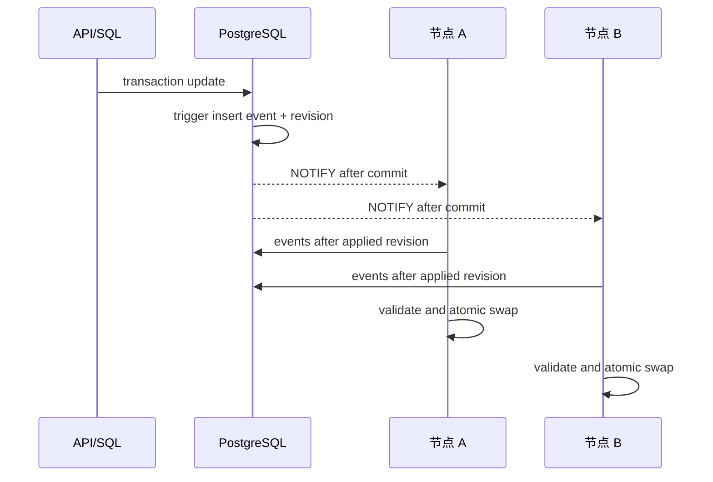

# 运行配置同步

## 一致性模型

PostgreSQL 保存最终事实；`LISTEN/NOTIFY` 只缩短延迟。API、脚本、旧 .NET 或 migration 直接写配置表都经 trigger 产生 event/revision。节点只在完整候选通过验证后原子替换 snapshot。

## 固定参数

- channel `yaginx_config_changed`。
- notify debounce 100ms，单飞 reconcile；`configsync.ListenWithOptions` 的单 wake worker 合并 burst，避免并发 build。
- revision poll 30s。
- LISTEN reconnect 250ms exponential，max 30s；连接 acquire、`LISTEN` 或 wait 失败均使用同一 bounded backoff，成功订阅后重置为 initial。
- event incremental batch 500。
- event minimum retention 24h；超过 7 天无 heartbeat 的节点不参与保留水位。
- reload generation 强制 full load。

全部参数可在 [runtime schema](contracts/runtime-config.schema.json) 查看；loader materialize default 后验证。

`serve` 启动后及每 24 小时执行 event retention：只删除早于 `eventRetention` 且不高于所有活跃 `approved/draining` 节点最小 `applied_revision` 的 event。超过 `inactiveNodeAfter` 未 heartbeat 的节点不参与该水位，恢复后按本章 full load 规则追平，不能要求长期保存全部 event。

## Reconcile 算法

1. 启动读取 singleton revision，执行 full load。
2. LISTEN dedicated connection 收到 payload 后只作为 wakeup，查询 database revision，不信任 payload 即完整游标。
3. 查询 `id > applied_revision ORDER BY id LIMIT incrementalBatchSize+1`；连续且不超过 batch 的 event 才有资格增量应用。
4. website `insert/update/delete` 读取单个受影响 row，并按稳定 website ID 替换或移除 immutable candidate site；`gateway_certificate` 保持 proxy candidate、仅替换 SNI certificate manager；`web_domain` 和 `gateway_system_setting` 推进 revision（其消费者直接从数据库读取）；unknown type、ID gap、row 缺失或 batch overflow 都立即 full load。
5. 本地 revision 小于 event table minimum、遇到 unknown type/gap、节点 inactive、reload generation 变化或增量验证无法证明完整性时 full load。
6. 完整校验 Host/rule/upstream/transform/certificate/setting 后 atomic swap。
7. swap 后写明文 snapshot，再更新 node applied revision、snapshot time/error。文件写失败不回滚内存，但 ready detail 显示 warning。
8. 构建/查询失败不推进 revision，继续使用旧 snapshot并按退避重试。

reconcile 运行期间出现更高 revision 时只设置 pending target；当前完成后立即下一轮，不并发 build。

## Snapshot 内容

- normalized Host -> website/default/child/simple/redirect index。
- compiled path/query/header transforms 和 transport key。
- SNI -> verified certificate chain/private key in process memory。
- system proxy settings、revision、build timestamp、schema format。

请求入口只 load 一次 atomic pointer。候选冲突和验证规则由 [代理矩阵](contracts/proxy-compatibility-matrix.md) 固定。

## Last-known-good

- 路径 `/var/lib/yaginx/runtime/snapshot.bin`，父目录 0700、文件 0600。
- 快照为受限本地卷中的明文；写入使用 telemetry 适配的 atomicfile file+parent fsync。
- 启动时只有 format、node ID、key version、GCM、certificate/private key 和 snapshot semantic 全部通过才可进入 degraded。
- DB 恢复后以 DB revision full load，不把 LKG 反写 DB。
- snapshot 高于 DB revision 视为环境/回滚冲突，节点不 ready并要求 operator 诊断，禁止把较新本地配置覆盖数据库。

## 节点身份与心跳

- identity 路径 `/var/lib/yaginx/node/identity.json`；UUID v4 + machine-id SHA-256 fingerprint，格式见第 13 章。
- 首次注册 pending；approved 才有 0-1023 node number并可生成 Snowflake。
- heartbeat 15s，写 version、git SHA、status、applied revision、reload generation、snapshot error/time。
- 45s 未 heartbeat 标 stale；7 天后不参与 event retention。stale 不自动 disable，避免 DB/网络分区改变持久状态。
- pending/disabled 不申请证书、不运行 report writer、不承载四个业务 listener。

完整状态、进入/退出和恢复见第 12 章。
