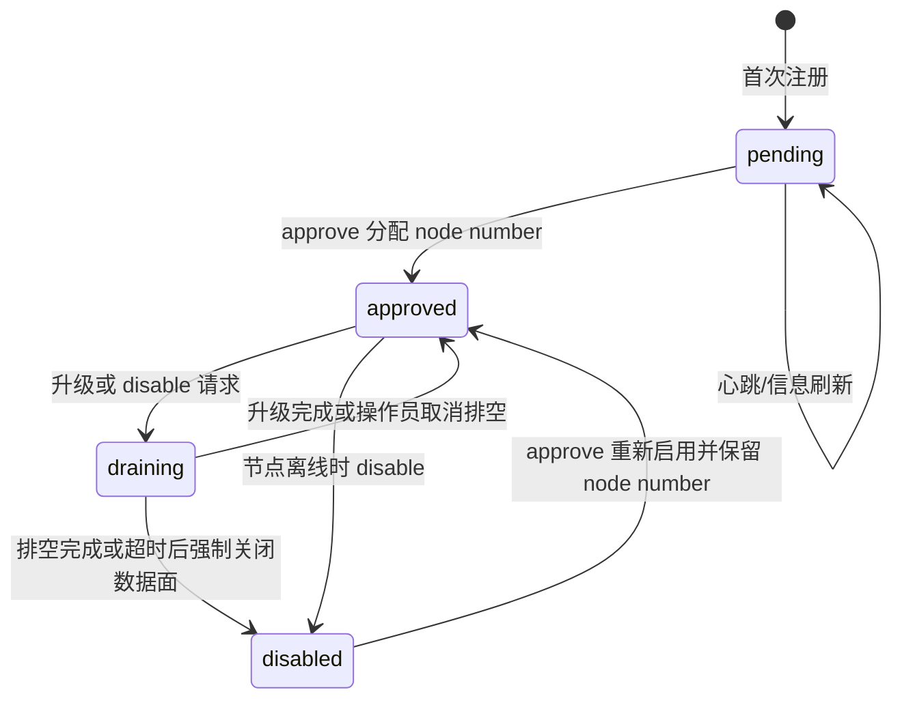
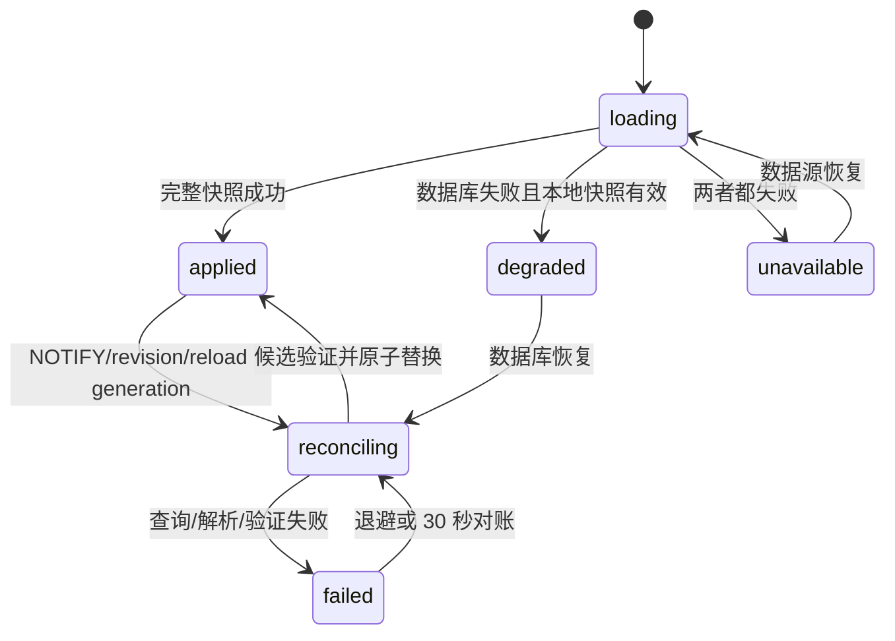
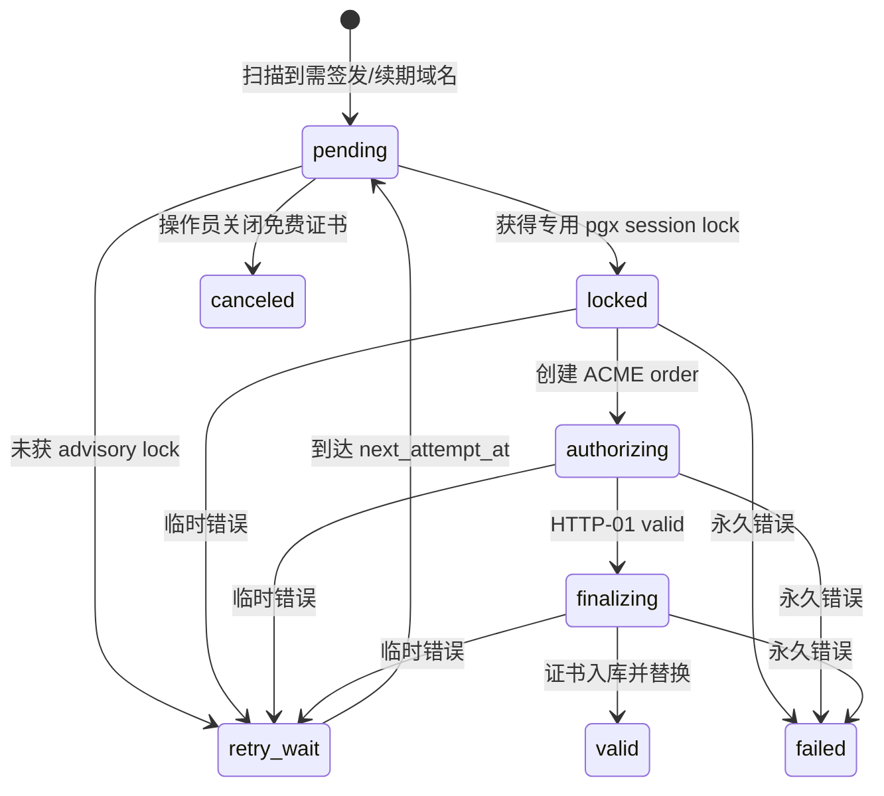
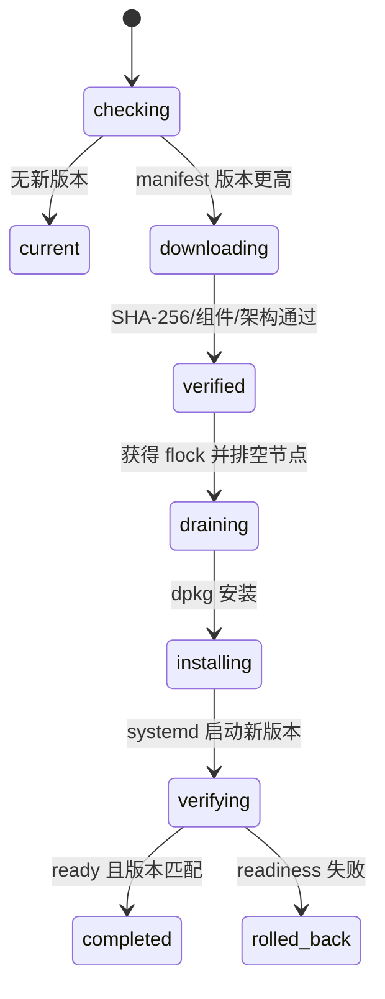

# 状态机与安全

本文集中定义所有需要跨请求、跨节点或跨重启保持一致的状态。状态字段、转换条件和恢复动作不得散落到 handler 中自行解释。数据库结构以 [`gateway/migrations/v2/00001_v2_baseline.sql`](../../gateway/migrations/v2/00001_v2_baseline.sql) 为准，运行配置以 [`contracts/runtime-config.schema.json`](contracts/runtime-config.schema.json) 为准。

## 节点持久状态

持久字段：`gateway_node.status`、`node_number`、`state_reason`、`state_changed_at`、审批/排空/禁用时间、revision、reload generation 和 heartbeat。节点记录不删除，因此已分配的 node number 在该记录存在期间永不复用。



| 状态 | 进入条件 | 数据面 | 退出条件 | 超时与恢复 |
| --- | --- | --- | --- | --- |
| `pending` | 新 node UUID 和 fingerprint 首次插入；`node_number=NULL` | 不启动四个业务 listener，只开放受限 live/ready 和节点审批 API | `approve` 在事务内分配 node number | 无自动审批；数据库恢复后继续 pending |
| `approved` | pending 首批审批，或 disabled/draining 被重新批准 | 有有效快照时承载流量并运行 ACME、聚合和报表任务 | 升级或 disable 进入 draining；离线节点可直接 disabled | heartbeat 超时只影响 ready/告警，不自动改变持久状态 |
| `draining` | approved 节点 CAS 更新；写 `state_reason=upgrade:<version>` 或 `disable:<reason>` | `monitorNode` 观察到状态后以 `node.drainTimeout` 调用业务 listener `Shutdown`，关闭 accept、拒绝新 HTTP/QUIC 会话并等待现有连接；随后完成 disable | upgrade 成功回 approved；disable 或排空超时进 disabled | 默认 5 分钟；超时取消剩余请求，刷新队列，记录强制排空原因 |
| `disabled` | draining 完成，或已离线 approved 节点被操作员禁用 | 不承载业务流量，不扫描 ACME；进程仍可提供管理健康信息 | `approve` 重新启用，保留 node number | 不自动恢复，避免被禁节点自行上线 |

### 审批并发

`approve` 使用一个数据库事务：

1. `SELECT ... FOR UPDATE` 锁定目标节点。
2. 获取 transaction advisory lock `pg_advisory_xact_lock(hashtextextended('yaginx:node-number',0))`。
3. pending 节点选择 `0..1023` 中未出现在任何 `gateway_node.node_number` 的最小值；没有可用值时返回 HTTP 500，`msg=调用异常`。
4. disabled/draining 节点保留已有 node number，不重新分配。
5. 写 `approved_at`、审批账户、state reason 和 change time 后提交。

fingerprint 必须是 Linux machine-id 去空白后 SHA-256 小写 hex。相同 node UUID 携带不同 fingerprint 时拒绝心跳并进入安全告警；相同 fingerprint 出现不同 UUID 时允许注册为 pending，但 `doctor` 报告克隆风险，审批由操作员决定。

## 进程运行状态

进程状态不写入 `gateway_node.status`，通过 health 和指标暴露。

| 状态 | 定义 | `/health/live` | `/health/ready` |
| --- | --- | --- | --- |
| `starting` | listener 或首个快照尚未就绪 | 200 | 503 |
| `ready` | approved、四个业务 listener 就绪、存在有效快照 | 200 | 200 |
| `degraded` | 数据库/通知不可用，但解密后的 last-known-good 有效 | 200 | 200，body 中 `degraded=true` |
| `draining` | 已停止接受新业务连接 | 200 | 503 |
| `stopping` | graceful shutdown 正在刷新队列和关闭连接 | 200，直到进程退出 | 503 |

pending 和 disabled 节点即使进程正常也返回 ready 503，reason 分别为 `node_pending`、`node_disabled`。health JSON 结构在第 8 章固定。

## 配置同步状态机



| 状态 | 持久化 | 进入与退出 | 故障恢复 |
| --- | --- | --- | --- |
| `loading` | 无 | 启动读取 current revision，执行完整加载 | DB 失败尝试本地快照 |
| `reconciling` | 本地目标 revision | 单飞执行；合并期间收到的更高 revision | 查询失败不推进 applied revision |
| `applied` | `gateway_node.applied_revision` 和受限本地卷中的明文快照 | 候选完整校验后先 atomic pointer swap，再持久化快照和节点 revision | 快照落盘失败不回滚内存，但 ready detail 报警 |
| `failed` | `last_snapshot_error` | 构建失败继续使用旧快照 | 250ms 起指数退避，最大 30s；revision poll 最迟 30s 再试 |
| `degraded` | 本地快照 header 中 revision | DB 不可用且本地快照、版本和证书校验成功 | DB 恢复后以数据库为权威重建 |
| `unavailable` | 错误日志 | 没有任何有效快照 | 业务 listener 不 ready，持续重试 |

增量事件游标早于事件表最小 ID、事件包含未知 resource type、单批超过 500 后仍有 gap、节点超过 7 天未心跳或显式 reload 时执行完整加载。reload API 递增 `reload_generation`；目标节点观察到后完整加载，成功或确定失败后写 `observed_reload_generation`，避免命令无限重放。

## ACME order 状态机

首版一个规范化域名一个 order，不自动组合 SAN。规范化顺序为 trim、去尾点、IDNA ASCII、小写；通配符直接分类为 permanent，不创建 HTTP-01 order。



| 状态 | 持久字段 | 锁与外部动作 | 超时/恢复 |
| --- | --- | --- | --- |
| `pending` | domain、attempt、created/updated | 尚未调用 CA | 扫描器选择 due row；也可从 web_domain 生成新 row |
| `retry_wait` | `error_class`、message、`next_attempt_at` | 不持锁 | lock conflict 为 60s + 0..15s jitter；网络/CA 退避 1m、5m、30m、2h、6h 上限 |
| `locked` | node、started_at、attempt+1 | 专用 session 执行 `pg_try_advisory_lock(hashtextextended('yaginx:acme:' || domain,0))`；成功后才允许创建外部 order | session 断开立即取消 request context；恢复扫描把超过 20 分钟且节点无锁/无心跳的 row 置 retry_wait |
| `authorizing` | order URL | `GET /api/key_value/set?key=<urlencoded token>&value=<urlencoded keyAuthorization>` 后等待 CA | 单次 challenge 10 分钟；key-value 非 200、超时、5xx 属 temporary |
| `finalizing` | order URL | 生成 ES256 key、finalize、下载完整 chain | 10 分钟；解析错误、私钥不匹配为 permanent |
| `valid` | certificate ID、finished_at | 同一事务插入新证书、停用旧证书、清空 `free_cert_message`、完成 order | 终态 |
| `failed` | `error_class=permanent`、稳定错误码和脱敏文本 | 同事务把 `web_domain.is_use_free_cert=false` 并写中文 `free_cert_message` | 终态，操作员重新开启后创建新 pending row |
| `canceled` | operator reason | 不调用 CA | 终态 |

专用锁 session 从 `locked` 到证书事务提交全程保持。锁释放或连接中断后不得继续使用已创建的 ACME order。释放使用同一 session 的 `pg_advisory_unlock`；进程退出依赖 PostgreSQL 自动释放作为最终保障。数据库 active-domain partial unique index是第二道保护，不能替代 advisory lock。

实现中未获 lock 的节点只写本地 `retry_wait` 与 `next_attempt_at=now+60s+0..15s`，不创建 CA order 或调用 key-value set。任一节点进入 `valid` 时，同域名仍处于 `pending/retry_wait` 的并发残留 order 统一改为 `canceled`，防止后续无意义重试。

### HTTP-01 读取

网关 challenge 请求调用：

```text
GET https://configurable.example.invalid/api/key_value/get?key=<urlencoded token>
```

只接受 HTTP 200、JSON 信封 `code=200` 且 `data` 为非空字符串。命中时返回 `application/octet-stream`，body 为 `data` 的 UTF-8 精确字节，`Content-Length` 为字节数；未命中、信封错误或临时读取失败继续普通代理路由。客户端不跟随 redirect，单次超时 10 秒。

## 证书生命周期

证书状态由 `is_active`、有效期和 `replaced_by_id` 推导：

| 派生状态 | 条件 | 可用于 SNI | 转换 |
| --- | --- | --- | --- |
| `staged` | 已入库但 `not_before` 未到 | 否 | 时间到后 active |
| `active` | `is_active=true` 且当前时间在有效期内 | 是 | 新证书事务替换或到期 |
| `superseded` | `is_active=false` 且 `replaced_by_id` 非空 | 否 | 保留审计，不删除 |
| `expired` | 当前时间不早于 `not_after` | 否 | ACME 扫描创建续期；保留审计 |
| `disabled` | `is_active=false` 且无 replacement | 否 | 仅人工修复可重新启用 |

替换事务先插入并验证新证书，再把同域名旧证书设 inactive/replaced，最后提交。配置触发器只在提交后唤醒节点，因此不会发布证书空窗。证书 PEM chain 和 PKCS#8 私钥明文保存于 PostgreSQL；私钥不写入本地独立文件，数据库及其备份必须受保护。

online full reload 把已验证的 proxy snapshot 和 certificate PEM material 一并写入受限本地卷中的明文 LKG。数据库中断时已运行节点继续使用内存中的已加载状态；新节点必须等待数据库恢复后启动。

## 密码找回状态机

| 状态值 | 名称 | 进入条件 | 允许动作 | 终止/恢复 |
| --- | --- | --- | --- | --- |
| 0 | `Pending` | start 创建 32 字符小写 hex recovery ID | verify_email | Completed/Invalid 记录不可复用 |
| 1 | `EmailVerified` | 邮箱不区分大小写相等，生成 6 位 code、16-byte Base64 salt、10 分钟期限 | reset；再次 verify 会生成新 code 并把 attempts 清零 | 过期或第 5 次错误进入 Invalid |
| 2 | `Completed` | code 正确且账号存在，事务内更新 password salt/hash | 无 | 终态 |
| 3 | `Invalid` | code 过期、错误达到 5 次或显式失效 | 无 | 终态，重新 start |

找回服务内部按以下中文业务原因分类：`账号邮箱不能为空`、`账户不存在`、`账户邮箱无效`、`找回流程不存在或已失效`、`找回流程已失效，请重新发起`、`邮箱校验失败`、`新密码不能为空`、`新密码与确认密码不一致`、`请先完成邮箱校验`、`验证码已失效，请重新发起找回流程`、`验证码已过期，请重新发起找回流程`、`验证码错误`。当前 .NET golden 对这类 controller/repository exception 的 wire 行为固定为 HTTP 500、`msg="调用异常"`、`errMsg=""`、动态 `requestId`；Go 将原因只写入脱敏日志和指标，不能将其自行暴露为 API `errMsg`。具体非空 `errMsg` 仅能由同 operation 的黄金 fixture 明确授权。

Go 更新密码只写 `password_salt` 和 `password_hash`，不再写明文 `account.password`。旧明文列保留给回滚审计，但不得读取、日志输出或复制到新表。

## JWT 材料迁移与轮换

### 切换

1. 完成数据库 migration 后，首个 Go 服务实例在 PostgreSQL advisory lock 下生成 current JWT 材料。
2. 全部实例读取 `gateway_runtime_material` 的同一 current/previous 值。
3. issuer、audience、claims、`nbf=-30s`、`exp=10m+30s`、cookie 和 `expiresIn=600` 保持兼容。

### 轮换

轮换不改变 JWT header，不要求 `kid`：

1. 在单例记录中保留 current 为 previous 并写入新的 current。
2. 记录触发配置事件；所有在线节点重载后只用 current 签名，并按 current、previous 顺序验证。
3. 等待 session + clock-skew 窗口后清空 previous 并再次发布事件。

轮换不依赖节点文件；日志和 metrics 不输出材料正文。PostgreSQL 读取权限等同于 JWT 签名权限。

## 升级状态机

首版只允许人工执行 `yaginx upgrade --check` 和 `yaginx upgrade`，没有 timer 或自动循环。



升级使用 `/run/yaginx/upgrade.lock` 的 crash-safe flock。manifest 必须包含 `component=yaginx`、SemVer version、HTTPS package URL、64 位 hex SHA-256、UTC publish time、`amd64` architecture 和 git SHA。下载到同文件系统临时文件，校验后执行 `dpkg --force-confdef --force-confold -i`。新进程 90 秒内必须 ready、报告目标版本和相同 node ID；失败时安装本地保留的前一 Debian 包并验证 ready。升级过程不管理 PostgreSQL、Redis 或其他系统服务。

## 安全边界

- 运行用户固定为非 root `yaginx`；只有 package maintainer script 使用 root 创建目录、绑定 capability 或重启 systemd。
- 管理 API 只通过 `/yaginx_console/api/` 暴露；metrics/health detail 使用独立管理 listener 和 CIDR allowlist。
- 日志禁止输出 Authorization/Cookie、密码、recovery code、SMTP password、DSN、证书私钥、ACME account key、密文或完整请求 body。
- SQL 全部参数化；动态排序、字段和 transform 名称只能来自合同白名单。
- 代理不会信任不在 configured CIDR 的 PROXY header；外层负载均衡必须覆盖而非追加客户端提供的 forwarded header。
- `configurable.example.invalid` client 禁止 redirect、限制 10 秒和 64 KiB 响应体，只接受 JSON content type 和既有信封。
- 本地 identity、snapshot、upgrade state、secret 目录不得是 world/group writable；`doctor` 发现权限过宽时 production check 失败。
