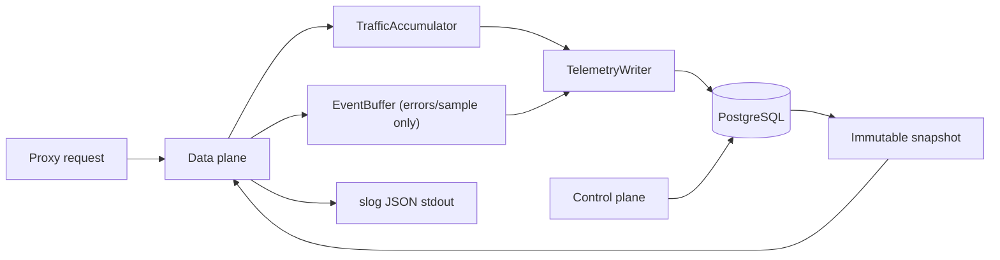

# V2 极简基础设施运行时

## 状态与适用范围

- 状态：`PLANNED`。
- 本章是 Go v1 功能型 Release Candidate 之后的 R7/v2 重构基线。
- 第 01-15 章、`contracts/` 和已有验收报告继续是 Go v1 的历史合同与证据；本章不追溯修改它们的完成事实。
- R7 实现发生冲突时，本章优先于第 02、08、10、11、14 章中的观测、目录和测试叙述。R7 开始编码前，必须单独版本化新的 OpenAPI、runtime schema 和数据库迁移合同；不得修改 v1 合同来伪造 v2 已完成。

## 固定决策

Yaginx v2 的生产依赖收敛为：

- `yaginx` 单一 Go 二进制。
- PostgreSQL 16，作为唯一共享数据库。
- Docker stdout/stderr 或 systemd journald，作为结构化运行日志承载。
- 受限本地卷中的 node identity 与 last-known-good (LKG) snapshot。

v2 不引入 ClickHouse、Prometheus server、OTLP collector、SQLite、Redis 或文档数据库。SQLite 不作为配置、队列、spool 或节点间共享状态，以避免第二套一致性、备份和故障恢复模型。

PostgreSQL 仍是配置、revision/event、节点、证书、ACME、动态设置和聚合数据的权威来源。数据面不得同步写 PostgreSQL；数据库不可用时，已加载的 snapshot 必须继续转发。

## 数据边界与保留

| 数据 | 存储 | 写入模型 | 默认保留 |
| --- | --- | --- | --- |
| 配置、节点、证书、ACME、用户、审计 | PostgreSQL | 事务写入 | 产品生命周期 |
| 分钟聚合 | PostgreSQL | 每节点/进程有限窗口 absolute upsert | 7 天 |
| 小时与日报聚合 | PostgreSQL | 由已关闭窗口 materialize | 365 天 |
| 错误请求历史 | PostgreSQL | 有界队列批量写入 | 72 小时 |
| 成功请求历史 | PostgreSQL | 默认关闭；显式采样才写入 | 24 小时 |
| 运行与访问日志 | JSON stdout/journald | 结构化输出，非数据库事实 | 由容器或 journald 策略决定 |
| identity 与 LKG | 本地受限文件 | 原子替换 | 覆盖式保存 |

原始请求 body、Cookie、Authorization、JWT、密码、恢复码、SMTP 密码、DSN、私钥和未脱敏完整 header 不得写入 PostgreSQL、`/ops/status` 或 JSON 日志。错误历史只保留定位所需的脱敏元数据、分类、状态、受限 path class 和字节/时延统计。

运维排障使用现有运行环境的日志设施，不由 gateway 管理 JSONL 文件生命周期：

```bash
journalctl -u yaginx -o json | jq 'select(.PRIORITY <= "4")'
docker logs yaginx --since 30m | jq 'select(.level == "ERROR")'
```

如部署环境要求落盘，Docker 或 systemd 负责 rotation、空间配额和权限；gateway 只输出单行 JSON。

## 运行时模型



### TrafficAccumulator

每个请求仅对进程内分片计数器执行常数时间更新。计数器按 host、状态分桶、入/出字节、时延分桶和 UTC minute/hour 分组；不保存完整请求 event。

- flush 间隔固定为 15 秒。
- 内存只保留当前和前一个 minute/hour，以及最多两个等待重试的已关闭窗口。
- `TelemetryWriter` 仅写活跃窗口、刚关闭窗口和等待重试窗口；成功写入 final window 后立即淘汰，禁止扫描或重写进程启动以来的全部 period。
- 多节点使用 `(node_id, process_id, host, cycle, period)` absolute snapshot upsert；materializer 使用 PostgreSQL transaction advisory lock 生成产品报表。
- 数据库故障期间，最多保留两个可重试窗口；超出边界后丢弃最旧聚合窗口、增加 dropped counter 并写一条 WARN 日志。代理转发不等待 flush。

### EventBuffer

`EventBuffer` 只接收错误请求，或经过明确采样命中的成功请求。

- 默认容量 10,000，FIFO，非阻塞 `TryEnqueue`。
- `TelemetryWriter` 每 5 秒或积累 500 条时批量写 PostgreSQL。
- 失败 batch 保持原顺序并按 3 次有限重试处理；超限后整批丢弃，增加 dropped counter 并写 WARN。
- buffer 满时立即丢弃新 event；不得为了重试持续消费并丢弃尚未满的队列项。
- request handler 只构造已脱敏、大小有界的 event；不得同步等待队列、日志或数据库。

### RuntimeStatus 与 ops 接口

R7 新增内部状态接口，供 health、日志和管理查询共用：

```go
type RuntimeStatus interface {
    Snapshot() StatusSnapshot
}

type StatusSnapshot struct {
    Ready            bool
    NodeStatus       string
    Database         string
    AppliedRevision  int64
    DatabaseRevision int64
    Listeners        []string
    Traffic          BufferStatus
    History          BufferStatus
    LastFlushAt      time.Time
    LastFlushError   string
}

type BufferStatus struct {
    Depth   int
    Dropped uint64
}
```

`GET /ops/status` 只绑定 management listener，必须同时通过 management CIDR allowlist 和管理员 Bearer 认证。响应不使用 legacy API envelope，包含 `StatusSnapshot` 的安全子集；禁止返回 DSN、错误文本、上游地址、原始路径、请求 ID、证书 fingerprint 或任何 secret。`/health/live` 和 `/health/ready` 保持面向负载均衡的简洁语义，不依赖 `/ops/status`。

### Supervisor 与生命周期

`Supervisor` 是唯一的启动和关闭编排者：

1. 加载 config、identity、PostgreSQL runtime material 和 LKG/snapshot。
2. 创建但不宣布 ready 的 management、TCP 和 HTTP/3 listener。
3. 确认所有 listener 已成功绑定并且关键后台任务已登记后，更新 ready。
4. 在运行期间监督 config sync、heartbeat、ACME、telemetry writer 和 retention；不可恢复的 listener/task 失败必须将 ready 置为 false 并触发受控退出。
5. 收到终止信号后依序执行：ready=false -> 节点 draining -> 停止业务 accept -> 等待活动业务连接 -> 停止 event producer -> 限时 flush telemetry -> 保存 LKG -> 关闭 management listener、LISTEN session 和 PostgreSQL pool。

数据面 snapshot 继续使用 atomic swap。路由 transport 改由 `TransportRegistry` 按 destination、forward proxy、TLS policy 和 timeout key 复用；snapshot retire 后只有引用归零且达到 idle 生命周期的 transport 才关闭 idle connections。

## R7 实施包

| 工作包 | 输入 | 输出 | 验证 | 回滚边界 |
| --- | --- | --- | --- | --- |
| R7.1 Supervisor | v1 `serve` 生命周期与 listener 合同 | 明确 bind confirmation、任务监督、drain/flush shutdown | listener/HTTP3 启动失败、task crash、drain、shutdown 集成测试 | 保留 v1 启动路径，开关切回 |
| R7.2 Transport Registry | v1 proxy settings 与 snapshot | keyed transport acquire/release/retire，连接复用与回收 | reload、WebSocket/SSE、FD/heap soak、per-route TLS/proxy 测试 | registry 与旧 transport 并存，通过配置选择 |
| R7.3 有限窗口聚合 | v1 traffic contribution/report 表 | `TrafficAccumulator`、有限 pending window、绝对 upsert | 多节点重放、DB outage、24h heap/DB write 曲线、报表真值 | 旧聚合 writer 保留只读对比，切换后可恢复 |
| R7.4 错误历史 | v1 request history schema 与 601-610 合同 | `EventBuffer`、脱敏 event、有限 retry 与 retention | queue 满、失败重试、敏感字段扫描、采样和丢弃计数 | 保留 v1 history reader，恢复旧 writer |
| R7.5 RuntimeStatus | health、管理认证与 CIDR guard | 内部状态源和 `/ops/status` | auth/CIDR、字段脱敏、状态一致性、DB unavailable | endpoint 可独立关闭，不影响 health/data plane |
| R7.6 迁移与验收 | R7.1-R7.5、v1 reports | 双写核对、运维 runbook、删除计划 | 72h soak、DB outage、rolling restart、数据差异为零或等于 dropped | 保留旧表与 v1 binary，禁止 down migration |

R7.1 和 R7.2 完成后才能切换真实 listener/transport 生命周期；R7.3-R7.5 可并行，但均不得改变 v1 机器合同。R7.6 通过前不删除 Prometheus/OTLP 相关 Go 依赖、v1 `/metrics` endpoint、旧 telemetry 表或现有运行配置字段。

## 数据迁移、验证与回滚

1. 为 v2 新 writer 增加独立 runtime feature flag；初始只生成内存结果与比较日志，不写产品报表。
2. 启用受控 dual-write，将 v1 与 v2 聚合按同一 UTC window 对比 request count、bytes、status bucket 和 duration bucket。
3. 连续 72 小时无未解释差异后，v2 成为报表 writer；v1 writer 停止写入但保留 reader、表和回滚代码。
4. 错误历史先以 shadow 方式比较事件数、错误分类和敏感字段扫描结果，再切换 producer。
5. 完成 R7.6 后才创建 v2 machine contracts，并以新 release milestone 决定旧依赖和 endpoint 的删除日期。

发生任一情况立即停止扩大 v2 范围并切回 v1 writer：请求路径出现同步数据库等待、listener 已失败仍 ready、transport FD/heap 持续增长、聚合真值不一致、数据库故障导致代理错误率增加，或日志/ops 接口泄露敏感字段。

## R7 验收

- 在正常流量下，成功请求不创建 PostgreSQL request-history row，代理请求路径不调用同步数据库写。
- 24 小时 soak 中 accumulator state、heap、goroutine、FD、queue depth 和 PostgreSQL write rate 均不持续单调增长。
- PostgreSQL 中断 10 分钟时，已加载 snapshot 保持转发；可观测数据只按已声明的容量边界丢弃，并能在 `/ops/status` 和日志中审计。
- 多节点 minute/hour/day 聚合与生成流量真值一致；允许差异只等于明确记录的 dropped counter 增量。
- 所有 listener 已确认绑定、snapshot 有效、节点 approved 后才 ready；任何关键 listener 或监督任务退出都撤销 ready。
- `go test -race ./...`、文档合同检查、PostgreSQL 16 integration、长时性能与故障演练均通过并留存证据。
