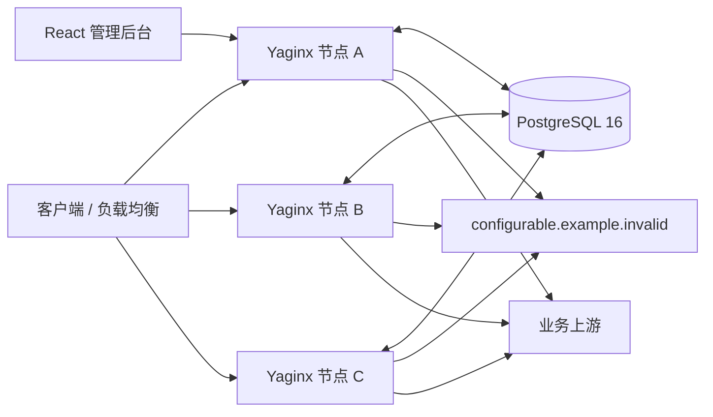
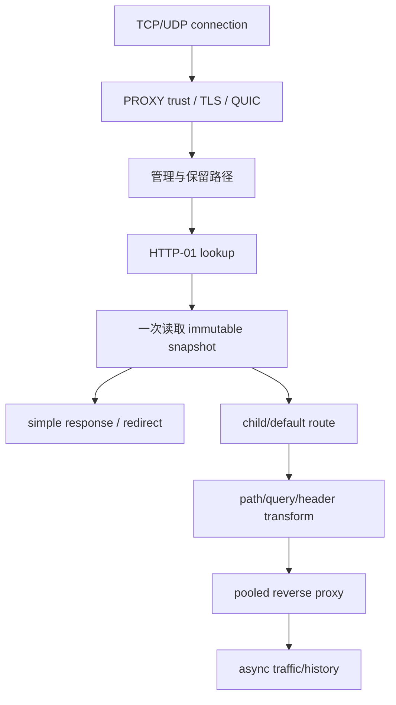

# 目标架构

> **Archived v1 design record.** This document is historical evidence only;
> v2 deployment and operations must follow the current OpenAPI and database
> lifecycle documentation.

> **v1 RC 范围。** 本章描述 Go v1 的目标架构和依赖基线。R7/v2 的极简基础设施设计见[第 16 章](../../16-minimal-infrastructure-runtime.md)，仅在 R7 范围内覆盖本章的观测、telemetry、listener 生命周期和 transport 管理叙述。

## 进程与命令

`gateway/` 使用 Go 1.25，module `yaginx-gateway`。单一 `yaginx` 提供：

- `serve`：代理、管理 API、React 静态资源、TLS/HTTP3、ACME、聚合、历史、报表、心跳和 health。
- `migrate up|status`：legacy baseline 检查和嵌入式 Goose SQL migration。
- `import-legacy`：只读导入 PFX、ACME account 和 SMTP setting，输出幂等报告。
- `doctor`：配置文件权限、DB/schema、port、PROXY trust、identity、snapshot、certificate 和 upgrade 检查。
- `upgrade --check`、`upgrade`：人工检查和受控滚动升级，无自动 schedule。
- `version`：version、git SHA、build time、Go version。

核心依赖固定为 `chi`、`pgx/v5`、`sqlc`、`goose`、`httputil.ReverseProxy`、`lego/v4`、`golang-jwt/jwt/v5`、`quic-go/http3`、兼容 PROXY Protocol library、Prometheus client 和 `slog`。目录目标见第 11 章，工作包见第 14 章。

## 实现复用边界

协议和传输层不从零实现：`httputil.ReverseProxy` 负责 HTTP 代理核心，`github.com/pires/go-proxyproto` 负责 PROXY v1/v2 解析，`github.com/quic-go/quic-go/http3` 负责 QUIC/HTTP/3，`github.com/go-acme/lego/v4` 负责 ACME/JWS，`crypto/tls` 负责 TLS/SNI。任何适配代码必须使用公开来源并记录许可证与差异，具体规则见[第 13 章](../../13-telemetry-component-reuse.md)。

Yaginx 自行拥有 PostgreSQL 权威数据、revision/event、immutable snapshot、旧 API、JSONB transform、流量报表和多节点 ACME advisory lock；不得复制 Edge Gateway 的 filesystem authority、Console control plane、fallback certificate 或自动升级模型。

## 多节点拓扑

每个 approved 节点具备完整数据面和管理面。节点之间不直接 RPC，不选 global leader；数据库事务、revision、唯一约束和 session advisory lock 协调。资源报表周期任务只使用短期 PostgreSQL advisory lock 选单次执行者，不形成长期控制面 leader。

## Listener

| 地址 | 合同 |
| --- | --- |
| 8080/TCP | HTTP/1.1 直连 |
| 9080/TCP | PROXY v1/v2 + HTTP/1.1 |
| 8443/TCP | TLS + HTTP/1.1/2 |
| 8443/UDP | QUIC + HTTP/3，使用同一 SNI snapshot |
| 9443/TCP | PROXY v1/v2 + TLS + HTTP/1.1/2 |
| 127.0.0.1:9090/TCP | 独立 management listener，AdminUI、管理 API、health/metrics，CIDR allowlist |

详细匹配和协议行为见 [代理兼容矩阵](../../contracts/proxy-compatibility-matrix.md)。

## 启动顺序

1. 读取 `/etc/yaginx/config.json` 并验证 schema；连接 PostgreSQL 后加载共享 JWT current/previous 材料。
2. 加载或生成 `/var/lib/yaginx/node/identity.json`，建立 build info 和 structured log。
3. 连接 PostgreSQL，验证 server >= 16 和 schema；`serve` 不执行 DDL。
4. 注册/刷新 `gateway_node`。pending/disabled 只启动 management listener，不承载业务。
5. approved 节点从数据库构建完整 immutable snapshot；失败时按第 12 章尝试解密本地 snapshot。
6. management listener 独占 admin static/API、health 和 metrics；四个业务 listener 对 `/yaginx_console` 返回 404。随后绑定四个 TCP listener、8443 UDP；全部成功后 ready。
7. 启动 LISTEN/NOTIFY、revision poll、heartbeat、ACME scan、traffic/history flush、report/retention 和 upgrade state recovery。

任一步不可恢复失败都关闭已启动组件并返回非零；不允许只启动部分业务端口后报告 ready。

## 请求流

每个请求只持有进入时 snapshot。配置替换对新请求立即生效，现有 HTTP、WebSocket、SSE 和 TLS connection 不被强制关闭；旧 transport 在引用归零后关闭 idle connection。

## 数据所有权

- PostgreSQL：动态配置、节点、证书/account、system setting、traffic contribution、legacy aggregate 和历史。
- 静态 config：DB/secret 路径、listener、timeout、pool、ACME endpoint、observability 和 upgrade manifest。
- 本地 identity：node UUID/fingerprint，持久且不由 DB 反向覆盖。
- 本地 snapshot：加密 last-known-good，只用于数据库暂时不可用，不反向写 DB。
- React files：只读 `/usr/share/yaginx/adminui`。

## 关闭顺序

收到 SIGTERM/SIGINT 后：ready=false -> approved 节点进入 draining -> 停止 TCP/UDP accept -> 等待业务和 ACME，最多 5 分钟 -> 停止 producer -> flush traffic/history -> 保存 snapshot -> shutdown management listener -> 关闭 LISTEN 和 pool。强制超时仍记录 dropped queue 和 active connection 数后退出。

状态、转换、恢复和升级详见第 12 章；配置字段和默认值详见 [runtime schema](../../contracts/runtime-config.schema.json)。
