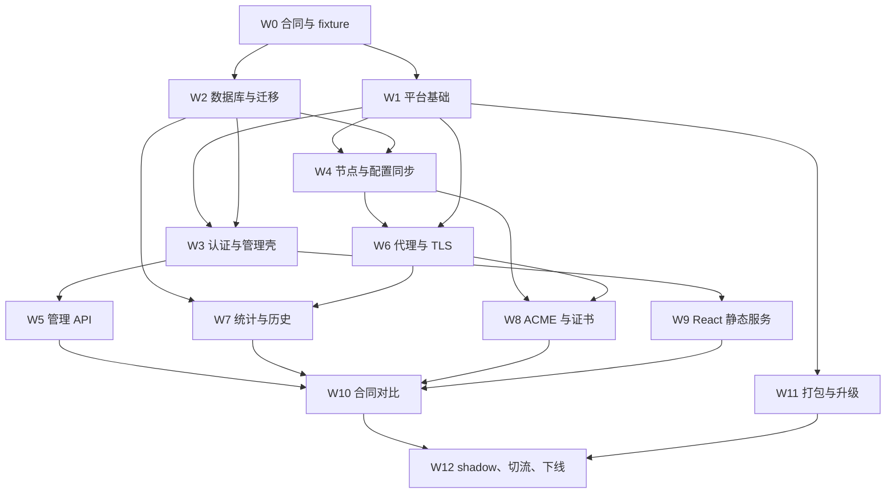

# 实施工作包

> **Archived v1 design record.** This document is historical evidence only;
> v2 deployment and operations must follow the current OpenAPI and database
> lifecycle documentation.

工作包是进入编码后的最小可交付单位。每个包有固定输入、输出、依赖、测试和完成门槛；未满足前置门槛不得通过接口猜测并行推进。目录名是目标布局，不表示当前 `gateway/` 已实现。总体里程碑、当前状态和优先级由第 15 章管理；本章不单独宣告工作包进度。

> **v1 RC 范围。** W0-W12 是 Go v1 的工作包和历史验收边界。R7/v2 不重写这些工作包；`Supervisor`、`TransportRegistry`、有限窗口聚合、错误历史、`/ops/status` 和迁移验收六项工作由[第 16 章](../../16-minimal-infrastructure-runtime.md)定义。

## 依赖图

## W0 合同与 fixture

**输入**：本目录 01-15 章、四份 `contracts/` 文件、当前 76 个 .NET 测试、固定 PostgreSQL fixture。

**输出**：

- `gateway/tests/contract/fixtures/`：每个现有 operation 的成功、匿名/认证、参数错误、业务错误、missing row 和 DB failure 脱敏 fixture。
- `gateway/tests/contract/proxy/`：Host/path/transform/CORS/stream/601-610 fixture。
- operation 映射校验器：OpenAPI 现有 operation 必须有 `x-dotnet-action` 和 `x-go-handler`；`x-origin=go-extension` 只要求 Go handler。
- schema/parser CI：OpenAPI 3.1、JSON Schema 2020-12、Mermaid 和 Markdown links。

**测试**：从 .NET 测试宿主或进程采集真实 HTTP 响应；归一化字段只允许 `tid`、token、cookie expiry、随机 ID 和当前时间。

**完成门槛**：现有 API 每个 method/path 至少一个成功和一个失败 fixture；代理矩阵每一行至少一个 fixture；fixture 采集命令可重复运行且不包含 secret/PII。

## W1 平台基础

**依赖**：W0。

**目标包**：`internal/platform/buildinfo`、`atomicfile`、`identity`、`httpx`、`lifecycle`、`upgrade`，以及 `internal/config`、`internal/auth`。

**输入合同**：runtime JSON Schema、第 12 章 key/file format、[第 13 章组件登记](../../13-telemetry-component-reuse.md)；平台辅助优先使用 Telemetry，atomic write/upgrade runner 优先使用 Edge Gateway。

**输出**：

- config loader：JSON -> env override -> defaults -> schema-equivalent validation -> immutable config。
- PostgreSQL 共享 JWT current/previous 材料、明文 row/snapshot codec。
- node identity、build info、structured `slog`、signal context。
- CLI 根命令和 `version`、配置级 `doctor`；`serve` 仍不得承载流量，直到 W4/W6。

**测试**：Telemetry identity/body/lifecycle/flock 向量；Edge Gateway `storage.go` atomic write 与 `upgrade/runner_test.go` 向量；atomic fsync、JWT rotation、snapshot corruption、config defaults/env/unknown field。`internal/platform/atomicfile/TestWriteRejectsSymlinkTargetAndParent` 在 Debian WSL 验证 direct/parent symlink，`TestWriteCreatesPrivateAtomicFile` 验证同目录原子替换与权限。

**完成门槛**：`go test -race ./internal/platform/... ./internal/config/... ./internal/auth/...` 通过；fuzz 运行 config、JSON 和 snapshot decoder 10 分钟无崩溃；日志扫描无敏感材料。2026-07-28 Debian WSL Go 1.25 已累计运行 config/configsync/certificates/repository/management fuzz 10 分钟，并额外运行 PROXY header fuzz 1 分钟；无 crash、panic 或保存的失败 corpus。

## W2 数据库与迁移

**依赖**：W0；可与 W1 并行。

**目标包/文件**：`internal/database`、`migrations/`、`sql/`、生成的 `internal/database/sqlc`。

**输入合同**：`contracts/database-schema.sql`、第 3 章 baseline 算法、固定 migration lock `6431500123034371919`。

**输出**：

- pgx pool 与 dedicated session helper。
- Goose custom table `gateway_schema_version` 和只前进迁移。
- legacy inspector，输出 machine-readable compatibility report。
- sqlc queries，禁止 handler 手写 SQL。
- `yaginx migrate up|status` 和数据库级 `doctor`。

**测试**：PostgreSQL 16 的 empty、complete legacy、partial safe、partial unsafe、duplicate host traffic、并发 migrate、旧 .NET 写入触发 event、角色权限。

**完成门槛**：empty schema 达到设计 DDL；完整 legacy 原 ID/行数/hash 不变；unsafe partial 零 DDL 退出；两个并发 migrator 只有一个执行；runtime role 无 CREATE/DROP 权限。

## W3 认证与管理壳

**依赖**：W1、W2。

**目标包**：`internal/auth`、`internal/management/envelope`、`internal/management/router`。

**输入合同**：OpenAPI 通用响应、JWT/password 规则、第 12 章 rotation。

**输出**：

- `/yaginx_console/api/` chi router、request `tid`、body limit、JSON camelCase 和 Int64 string codec。
- Bearer middleware、匿名 route metadata、401/403/500/503 envelope。
- legacy password hash、新 salt、JWT sign/verify、cookie。
- test-only handler adapter，用于在业务 API 完成前跑 auth fixtures。

**测试**：.NET token -> Go、Go token -> .NET、过期/nbf/audience/issuer/signature、current/previous key、cookie attributes、anonymous `user_info`、controller exception 500。

**完成门槛**：认证 fixture 字节级一致，除 tid/token 时间归一化；切换 key 验证测试通过；不存在默认开发 signing key fallback。

## W4 节点与配置同步

**依赖**：W1、W2。

**目标包**：`internal/nodes`、`internal/configsync`、`internal/runtimecfg`。

**输入合同**：第 5、12 章，database triggers，runtime schema。

**输出**：

- node register/heartbeat/approve/disable/reload repository 和 state machine。当前已实现 process startup register、UUID identity、heartbeat、approved gate、drain -> disabled 和五个 `gateway_node` API；仍须完成 Snowflake clock persistence、长期 soak 与 reload generation acknowledgement E2E。
- Snowflake generator：epoch `2026-01-01T00:00:00Z`、41/10/12 bits，时钟回拨策略见第 8 章。
- LISTEN/NOTIFY dedicated connection、revision poll、event replay/full reload。
- candidate builder interface、atomic snapshot owner、明文 last-known-good。当前 LKG 已同时保存 proxy snapshot 与已验证 certificate material；已运行节点在数据库 outage 时保留内存状态，仍须完成 corrupt certificate LKG 与跨版本升级 E2E。

**测试**：三节点审批竞争、1024 node number、clock rollback、通知丢失、event retention gap、DB outage/recovery、corrupt snapshot、reload generation。

**完成门槛**：三节点配置传播 P95 < 2 秒；30 秒内必然对账；candidate 失败不替换旧快照；race detector 和 6 小时 soak 无数据竞争或 goroutine 增长。

## W5 管理 API

**依赖**：W3；网站/域名写接口同时依赖 W4 的 revision trigger 已可用。

**目标包**：`internal/management/account`、`website`、`webdomain`、`traffic`、`history`、`report`、`settings`、`nodes`。

**输入合同**：OpenAPI 全部 schemas/operations、golden fixture、sqlc repositories。

**输出**：全部现有 API 和五个 gateway_node API；密码找回事务、SMTP file import 后 DB setting、30 秒 rule refresh throttle。

**测试**：每个 operation 表驱动运行 success/401/403/500/503；空值、Long string、GET/POST 双路由、200 null、分页 max 200、中文错误。

**完成门槛**：OpenAPI operation 100% 有注册 handler；React API client 不修改即可跑完现有页面；golden comparator 无未批准差异。

## W6 代理、PROXY、TLS 与 HTTP/3

**依赖**：W1、W4。

**目标包**：`internal/proxy`、`internal/listeners`、`internal/certificates/runtime`。

**输入合同**：代理矩阵、第 6 章、runtime config、candidate builder interface、Edge Gateway `proxyprotocol/listener.go`、`proxy.go`、`tls/manager.go`、`cmd/edge-gateway/main.go` 的登记测试向量。

**输出**：

- 8080/9080/8443/9443 listeners、PROXY v1/v2 trust、quic-go HTTP/3。
- website JSONB parser/validator、Host/path route index、transport pool lifecycle。
- transforms、simple response、redirect、CORS、blacklist、Expect Continue、Next scoped asset encoding。
- dynamic SNI selector和无证书 handshake failure。

**测试**：`internal/proxy/TestRuntimeExecutesGoldenFixtures` 必须执行所有可由 isolated HTTP upstream 表达的 .NET fixture，并为每个 raw-listener/fault-injection fixture 保留具名专用测试所有者；迁入 Edge Gateway 的 PROXY CIDR/header timeout、HTTP/3/Alt-Svc、WebSocket、SSE、chunked、trailers、1 GiB stream、client cancel、reload during long connection 测试向量。

**完成门槛**：Go P95 不高于同硬件 .NET 基线 110%；5xx 和 601-610 rate 不增加；连接/heap 24 小时稳定；8443 UDP 可用且 9443 无 UDP listener。

## W7 流量、请求历史与资源报表

**依赖**：W2、W6。

**目标包**：`internal/telemetry/traffic`、`history`、`reports`、`retention`。

**输入合同**：第 8 章、601-610 matrix、legacy table DDL、runtime settings。

**输出**：bounded queue、分钟聚合、host_traffic upsert、request_history capture/flush/retention、resource monitor -> minutely/hourly/daily report jobs。

**测试**：队列满 DropWrite、batch retry、body/header truncation、sampling、UA off/on、唯一键并发 upsert、报表零数据/跨周期、retention 分批删除。

**完成门槛**：故障注入不阻塞代理；聚合总数/bytes 与 fixture 一致；resource report API 和旧数据共同工作；每个周期 job 多节点只执行一次。

## W8 ACME 与证书存储

**依赖**：W2、W4、W6。

**目标包**：`internal/acme`、`internal/certificates/store`、`internal/importlegacy`。

**输入合同**：第 7、12 章、configurable.example.invalid 协议、database DDL、Edge Gateway `acme/{account,challenge,http01,renewal}.go` 与 TLS hot-load 测试向量。

**输出**：lego ES256 account/order、session advisory lock、HTTP-01 set/get、明文 PostgreSQL cert/account storage、PFX/account import、renew scan。

**测试**：三节点 same-domain、different-domain parallel、lock session loss、key-value envelope/encoding/no redirect、temporary/permanent 分类、wildcard reject、PFX empty password/idempotency；迁入 Edge Gateway HTTP-01 exact bytes/fall-through、lego account persistence、renewal window 和 certificate hot-load 向量，并改写为 PostgreSQL store/advisory-lock 断言。

**完成门槛**：same domain 外部 ACME order 并发数恒为 1；临时失败不关闭 free cert；permanent 失败原子更新 web_domain；新证书无重启 SNI 生效。

## W9 React 静态服务

**依赖**：W3；可与 W5-W8 并行。

**目标包**：`internal/adminui` 和 release asset embed/copy 规则。

**输入合同**：第 2、4、9 章和 runtime admin 配置。

**输出**：`/usr/share/yaginx/adminui` 静态 serving、base path、SPA fallback、cache headers、API isolation。

**测试**：hashed asset 1-year immutable、index no-store、deep link、missing asset、API 404 不返回 HTML、CSP/content type。

**完成门槛**：当前 React production build 无 API 改动运行；desktop/mobile browser smoke 全通过；静态资源不需要 .NET。

## W10 合同与故障验收

**依赖**：W5-W9。

**输出**：.NET/Go golden report、三节点 chaos report、性能报告、security scan、migration diff report。

**测试模型**：第 10 章固定流量模型，包括 70% 小 GET、15% JSON、10% SSE/WebSocket、5% 10 MiB-1 GiB 上传，HTTP/1.1/2/3 和四端口按比例覆盖。

**完成门槛**：API operation 全覆盖；P95 < .NET 110%；错误率不增加；config propagation P95 < 2 秒；DB outage、notify loss、node restart、ACME lock、upgrade rollback drill 全通过。

## W11 打包与人工升级

**依赖**：W1；最终 readiness 集成依赖 W10。

**输出**：Debian amd64、Docker image、systemd unit、install script、signed release manifest、`upgrade --check`/`upgrade`。arm64 不交付。

**测试**：fresh Debian、upgrade previous、rollback、non-root service、filesystem permissions、offline restart with snapshot、Docker TCP/UDP ports。

**完成门槛**：产物 SBOM 和 SHA-256；镜像/包无 dotnet/NuGet/C# artifact；人工升级只能持有一个 flock；readiness 失败自动回前一包。

## W12 Shadow、切流与 .NET 下线

**依赖**：W10、W11。

**输出**：shadow 记录、canary 记录、全量切换记录、迁移前 Git tag、.NET 发布包归档、最终删除清单。

**执行顺序**：

1. Go shadow：无外部业务流量、ACME off，只读同库并比较 config/API/import report。
2. 单节点 canary：停止该节点 .NET ACME/TLS writer，Go 独占 TLS/ACME，引入 1% -> 10% -> 50% 流量。
3. 全节点：每次一个节点 draining/切换，保持至少 N-1 ready。
4. 观察一个完整发布周期。
5. 删除 `backend/`、NuGet、dotnet CI/Docker/systemd 配置；保留 tag 和归档包。

**完成门槛**：第 10 章所有回滚触发未发生；生产指标持续满足阈值；仓库和 release 构建扫描找不到 `.csproj`、`.sln`、`dotnet` 构建命令或 .NET runtime layer。

## 并行开发边界

开发组织固定为一个主线集成者加最多两个 subagent：

- 每个 subagent 使用独立 worktree 和 `codex/go-rewrite-<milestone>-<lane>` 分支；一次只接收一个可独立测试的工作包。
- 主线集成者独占 `planning/go-rewrite/contracts/`、migration 编号、`go.mod/go.sum`、生成的 `internal/database/sqlc`、共享 envelope/router 和 `runtimecfg.Snapshot`。
- 公共依赖和 interface 在派发任务前由主线冻结；subagent 不单独升级依赖、不修改另一个 lane 的 package、不基于未合并分支继续开发。
- W0 可把 API fixture 与 proxy/database fixture 分给两个 subagent；fixture 归一化和合同变更由主线合并。
- W1/W2 可并行，只通过 runtime schema、DDL 和已冻结 repository interface 连接。
- W3/W4 可并行；W5 各业务 handler 可按 package 分配，但 envelope/auth/router 只有一个 owner。
- W6 可拆分 listener/PROXY/TLS/HTTP3 与 route/transform/transport；snapshot type 和代理集成入口只有一个 owner。
- W7/W8 可并行，但只能通过 bounded queue、repository 和 certificate event 接入，不向 proxy handler 增加同步数据库调用。
- W10/W11 可并行；R6 的生产数据库、ACME 启用、流量切换和最终删除操作只由主线集成者执行。
- subagent 交付必须列出工作包编号、变更范围、测试命令、测试结果、未完成项和合同偏差；缺少任一项不得进入合并队列。
- machine-generated artifacts 只由固定命令生成，禁止人工编辑或由两个 lane 同时生成。
- 每次主线合并后更新第 15 章状态和验收证据；只有完成门槛全部通过才能把工作包或里程碑标记为 `DONE`。
- 任何合同变更先改本目录并获得评审，再改实现和 fixture；实现 PR 不允许只改行为不改合同。
