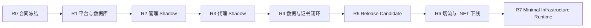

# Yaginx Go Rewrite 总体 Roadmap

> **Archived v1 design record.** This document is historical evidence only;
> v2 deployment and operations must follow the current OpenAPI and database
> lifecycle documentation.

本章是 Go 重构开发的总体进度、优先级和里程碑入口。第 14 章定义 Go v1 W0-W12 的详细输入、输出、依赖和测试门槛；R7/v2 的六项重构工作由[第 16 章](../../16-minimal-infrastructure-runtime.md)定义。本章负责回答当前位于哪个阶段、下一步做什么、哪些工作允许并行，以及何时可以进入下一个环境。

Roadmap 采用里程碑门禁，不按日期或代码行数宣告完成。目录、原型或部分测试存在不代表工作包完成；只有对应门禁全部通过后才能更新状态。

## 当前基线

- 基线日期：`2026-08-03`。
- 当前里程碑：`R7 Minimal Infrastructure Runtime`，状态 `NOT_STARTED`。R6 全量切流、14 天观察、每日核对和四类演练均已通过，当前仓库的旧后端与构建依赖已删除。
- 当前优先级：`P3`；R7 可按第 16 章启动。冻结的兼容合同、fixture 和历史验收报告继续保留，但不再需要旧运行时。
- R2-R5 的切流前外部验证已完成；相关脱敏记录保留在受控证据系统和 R6 观察记录模板中。历史本地验收报告保留其原始时间和结论。
- 本工作树已通过 `go test ./...`、`go vet ./...`、`go run ./cmd/contractlint` 与 `go run ./cmd/contractcheck`；后续进度以门禁状态和验收证据为准。
- 旧运行时的最后可部署发行物和 migration-pre-Go tag 已归档为外部回滚来源；当前仓库只保留 Go 实现与兼容证据。

### 2026-08-03：R6 验证完成与旧后端下线

- 14 个自然日观察、每日健康/指标核对、数据库中断恢复、节点滚动重启、证书热加载和升级回滚演练均已完成并通过。
- 运行证据、告警记录、数据库查询和报告继续保存在受控的非公开位置；仓库只保留脱敏模板和验收规则。
- 已归档旧运行时发行物与 migration-pre-Go tag，并完成旧后端、NuGet 和旧构建/运行资产的仓库清理。
- R7 可按 R7.1 -> R7.2 -> R7.3/R7.4/R7.5 -> R7.6 的顺序启动；R7.6 通过前仍保留 v1 writer、`/metrics`、OTLP 和旧 telemetry 表。

## 当前进度

- 2026-07-28：发布链可靠性修复完成本地实现。Docker/DEB 均打包 `adminui`，镜像补齐 CA、tzdata、非 root state/secrets 目录和 UDP 8443；Debian 首装交付非机密 config conffile。升级 runner 统一 Linux flock、严格 SemVer/HTTPS/no-redirect 校验、旧 deb 校验缓存、`ready=true`/version/node ID 验收和失败自动回滚。CI 新增二进制 build-info SPDX SBOM、版本化 installer、对象覆盖拒绝、manifest-last 顺序及包/镜像内容检查。GHCR/GitHub Releases、Docker pull/build/push 和真实 systemd 安装/回滚仍为 R5 Manual Testing Item；独立发布签名延后至 v1.1+，当前风险已在第 09 章登记。

- 2026-07-28：Go 发布链已定义为 Hub 镜像和共享 Go/Node 缓存，CI 会构建不可变 `BaseVersion.CI_BUILD_NUMBER` Debian 包、SHA-256、SPDX SBOM、Docker 镜像与 GitHub Releases `latest-release.json`。发布、Hub、GitHub Releases、package install 和 systemd 的真实环境执行尚未完成，均属于 R5 Manual Testing Item；不得把旧 PowerShell 产物或历史 RC 报告当作当前链路的发布证据。

| 工作范围 | 状态 | 初始估计 | 优先级 | 验证事实 |
| --- | --- | ---: | --- | --- |
| 设计与机器合同 | `DONE` | 100% | P0 | 01-15 章、OpenAPI、PostgreSQL DDL、runtime schema、proxy matrix 和[组件复用登记](../../13-telemetry-component-reuse.md)已建立；本轮核验 19 个 Edge Gateway 与 8 个 Telemetry 源码/测试路径、两仓库 remote 和固定 commit，`contractlint` 通过。 |
| W0 合同与 fixture | `DONE` | 100% | P0 | 41 OpenAPI operation、81 proxy matrix 行全部由真实 .NET fixture 或具名批准证据覆盖；独立管理 listener、route-value fail-closed 和测试适配器均有合同记录。验收见 `gateway/tests/contract/r0-acceptance.md`；最后验证基于工作树的 `04a3cded95914314ac99ad335da1718a13199889`。 |
| W1 平台基础 | `DONE` | 100% | P0 | schema loader、PostgreSQL 共享 JWT、identity、atomicfile、lifecycle、doctor/version/upgrade 与登记测试向量已完成；Debian WSL 10 分钟 fuzz、symlink/permission/fsync 和 race 证据已通过。 |
| W2 数据库与迁移 | `DONE` | 100% | P0 | 最终 DDL 对齐、固定 migration lock、legacy baseline、pgx/sqlc 与 runtime role 权限已完成；PostgreSQL 16 harness 已验证空库、完整 legacy checksum、安全 repair、unsafe partial、并发锁和最小权限。 |
| W3-W11 | `DONE` | 本地功能实现完成 | P0-P2 | 功能型 RC、本机自动化证据和外部环境验证均已完成；生产切流结果已由 R6 观察与演练确认。 |

当前 `gateway/` 已形成可验证的功能型 RC 本地实现。R0/W0 与 R1 均已完成；以下条目是 R1 及后续工作包的实现清单，而非 R0 blocker：

- API inventory 已从 OpenAPI 校验 41 个 operation，不继续维护手写 36 条清单；仍须在固定可写 PostgreSQL fixture 的 .NET 宿主上采集真实 API/proxy golden。
- migration 对齐 `contracts/database-schema.sql`，包括节点 `draining`、UUID、revision/event、证书、状态约束和角色权限。
- migration advisory lock 使用合同固定常量 `6431500123034371919`，并补齐 complete/older/safe-repair/unsafe-partial baseline 判定。
- config loader 对齐完整 runtime schema、默认值、环境变量和受限 `config.json` 内嵌 DSN，不继续使用简化的 URL/port 结构作为生产合同。
- `sql/queries` 提供可生成和可测试的 sqlc query；占位注释不得计入 W2 进度。
- CLI help、README 和实际命令行为保持一致；未启用命令必须明确拒绝，已启用命令必须执行对应门禁测试。

## 最近进度记录

### 2026-07-28：本地实现完成，转入人工环境验证

- 2026-07-28：复审发现并修复三个本地 P1 缺口。此前 runtime schema 的 proxy transport/listener 参数仅有默认值但未接线；现已将 timeout、连接池、header/body limit 与 HTTP/3 idle timeout 传到业务数据面。此前合同中的选择性 `UpstreamExpectContinue` 和 `ipBlacklistCIDRs` 未执行；现已实现并覆盖主机/segment prefix/Upgrade/已有 Expect、legacy 首个 X-Forwarded-For、ACME challenge bypass 和非法 CIDR fail-closed。React 静态服务同时按合同对 `index.html`/SPA fallback 使用 no-cache、对 `/assets/` 使用 immutable cache。对应 unit 和全量 Go/合同/PostgreSQL 16 门禁均通过。

- 2026-07-28：持续本地合同审计修复三个可验证 P1 偏差。9080/9443 的 `requiredOnProxyListeners=true` 现使用 Edge Gateway 同源的 trusted-peer policy，且预读 header 后在传输层拒绝缺失/无效 PROXY header，不再让 `net/http` 把直连转成 400。请求追踪不再绕过请求体限制，HTTP/3 同样使用限制 handler。`configSync.notifyDebounce`、initial/max reconnect backoff 已从 runtime schema 接入 dedicated LISTEN worker；burst notification 单飞合并。traffic queue 现执行 `excludedPathPrefixes`，并按 `updateCurrentPeriod` 决定是否持久化未关闭周期。对应 listener real-socket、configsync、telemetry 和 app 单测覆盖已加入；完整回归证据在本次门禁完成后更新。

- 2026-07-28：节点生命周期审计消除了两处 runtime config 的硬编码偏差。`node.heartbeatStaleAfter` 已注入 repository 的 disable 决策，过期节点直接 disabled，仍活跃节点先进入 draining。draining 节点不再立即取消整个进程：`monitorNode` 以 `node.drainTimeout` 对业务 listener 执行 graceful shutdown，再完成数据库状态转换和停止进程；管理 listener 的收尾仍由统一 lifecycle 负责。PostgreSQL management integration 覆盖 stale node 的 direct-disable 分支。

- 2026-07-28：报表 writer 的多节点锁由固定字符串改为 `resourceReports.leaderLockNamespace` runtime 配置；`serve` 在启动时把该值注入 repository，minute/hour/day absolute UPSERT 仍在同一 PostgreSQL transaction advisory lock 下执行。该变更不改变既有 report 字段或 legacy API 输出。

- 2026-07-28：复审补齐 `resourceReports` 调度合同。启用时 minute 边界后 `minutelyDelay` 触发常规 contribution report reconciliation，hour/day 边界后的 `hourlyDelay`/`dailyDelay` 强制额外校正；同一周期只触发一次。`enabled=false` 不启动 report writer，legacy backfill 后的首次同步补齐保持原有迁移安全性。`TestReportMaterializerScheduleHonorsPeriodDelays` 固定 delay、去重和 hour/day key 行为。

- 2026-07-28：config event retention 已接入 `eventRetention` 和 `inactiveNodeAfter`。每天的数据库任务只删除已超过时间窗口且已被所有活跃 approved/draining node 确认的 event；过期 heartbeat 节点不阻塞水位，恢复时走 full snapshot。PostgreSQL integration 验证已确认的过期 event 会被清理。

- 2026-07-28：最终审计修复 `resourceReports.enabled=false` 仍执行 legacy monitor backfill 的边界问题。现在关闭 report writer 同时禁止 backfill、首次 materialization 和周期任务，避免操作员明确禁用后仍写入 `resource_report`。

- 2026-07-28：W7 复审修复了 Go contribution 仅写 status、导致切流后 `resource_report` 丢失 duration bucket 和 UA 维度的问题。每个 process 的 absolute contribution 现在持久化 status/spider/browser/OS/duration buckets，并在 closed period 写 `is_final=true`；cycle 5/10 materializer 与 cycle 20 日报均合并这些 JSONB 维度和整数 avg/max。UA 改用 `github.com/ua-parser/uap-go/uaparser` 的维护 regex corpus 和有界 cache，而非手写浏览器/OS parser。PostgreSQL 16 harness 首次暴露 numeric JSON avg 到 bigint 的类型错误，修正为显式 numeric/int conversion 后，双节点重放、小时/分钟/日报及 UA/duration assertions 全部通过。

- 用户决定对无法由当前工作树自行提供的环境门禁先行跳过并继续后续开发。已完成的 R2-R5 本地实现不再因为外部环境被误写为 `NOT_STARTED` 或 `IN_PROGRESS`；它们均进入 `BLOCKED`，详见本章“Manual Testing Item 队列”。这不是上线批准，也不改变 R6 必须在生产 shadow/canary/观察期后才可删除 .NET 的约束。

- 本轮本机 `adminui/node_modules` 曾出现已安装依赖文件的瞬态语法损坏；以现有 `pnpm-lock.yaml` 执行 `pnpm --dir adminui install --frozen-lockfile --offline --ignore-scripts` 后，`npm --prefix adminui run build` 恢复通过。没有修改 package manifest 或 lockfile。随后 `go test -count=1 ./...`、`go vet ./...`、`go run ./cmd/contractlint`、`go run ./cmd/contractcheck` 与 `go run ./cmd/proxycheck` 全部通过。

### 2026-07-27：R1/R2/R3/R5 实现进行中

- 2026-07-28：R2 本地数据库故障门禁从 unit-level guard 提升为真实 `serve` 拓扑集成：`TestServeRetainsLKGAndRejectsManagementWritesDuringDatabaseOutage` 让应用经测试拥有的 TCP forwarder 连接 PostgreSQL 16，关闭 forwarder 后已建立连接和重连均失败；受保护管理写返回标准 `503`/`requestId` 信封，8080 上的已加载 simple response 继续由内存 LKG 成功服务。该证据不替代 10 分钟流量、恢复 SLO 或生产网络演练，后者保留 Manual Testing Item。

  - 2026-07-28：R2 API golden 从 inventory 提升为可执行 handler replay：`internal/management/TestAccountFixturesReplayThroughGoRouter` 已逐一重放全部 72 份 fixture；`accountUserInfo` 的 failure 仍是批准的 test-only forced adapter，生产 endpoint 保持匿名成功。回放比较 HTTP status、JSON content type、完整信封/data 与 login/refresh Secure HttpOnly cookie；`TestOpenAPIOperationsAreRegistered` 对 41 个 OpenAPI operation 阻止遗漏路由或错误方法退化为 404。回放修复了 legacy JWT `uid/uname/email/nbf/exp`、requestId、Task 空对象、SMTP middleware 500、refresh 30 秒节流，以及 traffic/history/report operation-aware DTO 边界。PostgreSQL integration 同时验证该三类查询的真实分页/聚合包装。当时 R2 仍待双运行时 golden；现已明确该外部环境门禁为 `API-DUAL-RUNTIME-GOLDEN`，因此当前状态见本章 R2 的 `BLOCKED` 行。

- 2026-07-28：W7 补齐 retention、完整 request-history policy 和 legacy raw monitor shadow backfill：启动及每 24 小时以独立批次清理 contribution/raw monitor/history/legacy traffic/report；默认启用 ErrorsOnly、AllMetadata sampling、7 天 history retention、分钟/小时/日报 30/365/730 天分级留存、bounded header/body capture、limited history retry 和 Snowflake persistence 都有 unit 或 PostgreSQL 16 evidence。旧 raw rows 在加密 cutover 前以 PostgreSQL JSONB aggregation 生成 cycle 5/10/20 report，marker 阻止重启重复扫描。
- 2026-07-28：`import-legacy` 已识别旧 LettuceEncrypt account JSON/DER，匹配 configured ACME directory 后明文导入 PostgreSQL，绝不覆盖 Go 已注册 account。management listener 已按 runtime `allowedCIDRs` 限制，提供 `/health/live`、`/health/ready` 结构化 JSON 与 Prometheus `/metrics`；Prometheus label normalizer 单测拒绝高基数输入。OTLP 已使用官方 SDK 和 gRPC/HTTP protobuf exporter 实现为默认关闭的脱敏 server tracing；真实 collector 网络、生产 CIDR 与 scraping 留作环境验证。

- 2026-07-28：补齐 R1 本地证据：Debian WSL Go 1.25 对 config、LKG、certificate/PFX、proxy transform、management JSON body 共累计 10 分钟 fuzz，另对真实 `go-proxyproto` header parser fuzz 1 分钟，全部通过；snapshot 拒绝 direct/parent symlink，atomic write 执行文件和父目录 fsync。PostgreSQL 16 harness 重跑通过空库、完整 legacy 行/ID/JSONB checksum、安全 index repair、recognized older、unsafe partial、固定 advisory lock 并发、管理/ACME/configsync 流和 runtime role。W1/W2 与 R1 由此完成。

- 本轮修复 00010 后 `gateway_certificate.fingerprint_sha256 char(64)` 与 legacy `fingerprint text` 共用参数导致的 PostgreSQL `42P08`；ACME PEM store 与 PFX import 均有 PostgreSQL 16 导入幂等/热加载测试。
- ACME 已从 HTTP-01 provider/lock 原型扩展为 approved-node worker：account/domain advisory lock、持久 account/order/retry、ES256 lego obtain、certificate replacement transaction 和 config-trigger reload。三节点 PostgreSQL 16 test 证明同域名 external issuance callback 恒为一次；真实 DNS/CA callback 留作 Manual Testing Item。
- node identity 新建为 canonical UUID（兼容读取早期 compact UUID）；`serve` 自动 register machine fingerprint，pending/draining/disabled 不启动业务 listener/ACME，approved node heartbeat 观察到 drain/disable 后停止数据面。gateway_node 五个合同 API 已注册并由 PostgreSQL integration 覆盖。
- online LKG 包含 route snapshot 与 certificate PEM，并以受限本地卷中的明文保存；已运行节点在数据库短暂中断时继续使用内存状态。
- request-history ID 已接入 `41/10/12` Snowflake generator：approved node number 是唯一 worker input，high-water 每秒/退出原子持久化，超过 5ms 的回拨 fail-closed。contribution materializer、report、retention、legacy raw backfill 及 history sampling 已实现；长期时钟回拨 soak 仍属于 R5 环境证据。
- `import-legacy` 已补齐 `/app_data/system.json` 的 SMTP 明文导入，兼容 legacy PascalCase 并只在 PostgreSQL 尚无 setting 时写入；同时识别旧 LettuceEncrypt account JSON/base64 DER，匹配 configured directory 后明文导入且不覆盖 Go 已注册账户。
- telemetry queue 不再在 sink 临时失败时直接清空 batch；traffic 保留 batch 并重试，history 在有限 retry 后显式丢弃并计 metric。minute/hour contribution/materializer、cycle 5/10/20 report、retention、raw shadow backfill、ErrorsOnly/AllMetadata sampling 与有界 metadata capture 均有本地测试证据；W7 的剩余门槛是长期性能/并发证据，而非功能缺口。

- R1 本地验证现固定为 `gateway/tools/test-postgres-integration.ps1 -Distro Debian`：Windows Go 工具链连接 Debian WSL Docker 的 `docker.io/library/postgres:16`，每次创建并清理独立容器与 schema。Debian WSL 当前为 Go `1.25.0` 且具备 `gcc`，可作为 Linux fuzz/race 证据环境。
- runtime loader 已把与 `contracts/runtime-config.schema.json` 字节同步的 Draft 2020-12 schema 嵌入 production binary；所有已声明 `x-env` 覆盖、nested PROXY 配置、duration 读取、log level/format、pool setting 和 PostgreSQL 16 version check 已接入 `serve`/`doctor`。数据库不可用仍进入 LKG；版本或合同不合格则 fail-closed。
- 新增 00010 forward-only schema alignment migration：在不删除旧 .NET 列或键的前提下补齐 revision/event、certificate/account/order、traffic contribution、约束和 schema-aware config trigger 所需字段；PostgreSQL 16 的空库、管理流和三节点 LISTEN/NOTIFY/revision-poll integration 已重新通过。complete legacy、recognized older/safe repair、unsafe partial 与 runtime 最小权限仍是 R1 未关闭门禁。
- `gateway/deploy/postgres/roles.sql` 现作为 migration 后可重复执行的部署资产；WSL PostgreSQL 16 test harness 已验证 `yaginx_gateway` 对 legacy/runtime 表有 SELECT、对 `public` 没有 CREATE。真实 login-role membership 与生产 DSN 仍在 Manual Testing 环境验证。
- legacy inspector 现只接受 .NET FluentMigrator `versioninfo` 的已知非空有序前缀（2026042800、2026042801、2026042802、2026050703）作为 safe repair 输入；旧 request-history status 列可由 migration 补齐。无 versioninfo 的 partial schema、残留 gateway table 或 JSONB->text 等关键类型变化均在 gateway DDL 前 fail-closed，并有 PostgreSQL 16 integration 覆盖。
- ACME domain lock 已用 `idna.Lookup.ToASCII` 规范化；PostgreSQL 16 integration 证明 Unicode/punycode 的同一域名不能并发持锁、不同域名可以并行、连接释放后可重试。account/order/renewal worker 已实现并有三节点 issuance test；真实 CA callback、legacy account import、long-running retry/renewal 仍是 W8 未关闭项。

- W1 已加入 runtime document 默认值/环境覆盖、PostgreSQL 共享 JWT current/previous、明文 LKG、identity 和原子文件写入；Draft 2020-12 schema 已字节同步嵌入 production binary 并由 `serve`/`doctor` 使用。
- W2 使用固定 advisory lock `6431500123034371919`；00006 将 node ID 升级为 UUID，并将非 UUID 历史 node 作为 unsafe baseline fail-closed。00010 完成最终 DDL 对齐；sqlc `v1.29.0` 已生成，PostgreSQL 16 harness 通过 baseline、repair、unsafe、并发 lock 和角色最小权限门禁。
- `sql/queries` 已从占位符替换为 account/website/domain/node/SMTP/certificate/traffic/history 命名 query；sqlc `v1.29.0` 已生成 `internal/database/sqlc`，并以 `gateway/tools/generate-sqlc.ps1` 固定生成器版本。00008 补齐 `gateway_system_setting.content_type`，独立 schema migration 已验证。
- W3/W5/W6/W7/W9 已有 chi envelope/router、PostgreSQL repository 边界、HS256 auth、热替换 fail-closed proxy、LKG poller 与异步 telemetry queue；这些是实现输入，不等同于各 W 的完成。
- 本轮进一步接入 `serve` 生命周期：管理 listener、8080/9080/8443/9443、8443 UDP HTTP/3、严格 trusted PROXY v1/v2、内存 SNI snapshot、数据库网站 snapshot、PostgreSQL LISTEN/NOTIFY + revision poll、节点注册/审批/心跳和 PostgreSQL PFX 明文 store。空证书或不合格候选保持 fail-closed/LKG；完整 API 与全面 proxy matrix/report E2E 仍是未通过门禁。
- ACME 使用 `lego/v4` provider contract 的 HTTP-01 key-value adapter，并接入业务 listener challenge 优先路由；跨节点 domain lock 保持 dedicated PostgreSQL session。已通过远程 Docker Pebble 签发集成测试（`YAGINX_PEBBLE_DIRECTORY` 指向测试目录，验证 bypass 仅用于 Pebble 的本地 CA）；真实可解析域名的 HTTP-01 回调仍是生产前外部验收项。
- 代理请求现异步投递 telemetry queue，采集状态码、收发字节与耗时；批处理以 host/hour 聚合写入 `host_traffic`，并以数据库 sequence 写入最小化、无 header/body 的 `request_history`。proxy request path 不执行同步数据库写。主站 path/query/header/response-header transforms 与 child rule route 已实现，完整历史 transform matrix 与报表 E2E 仍是 W7/W6 未通过项。
- W11 的当前实现定义 Linux amd64 可重复构建、SHA-256、基于发布二进制 build info 的 SPDX SBOM、Dockerfile、Debian conffile 和 systemd unit；新 GHCR/GitHub Releases 发布链仍须在授权环境执行并保留证据。发行物当前无独立签名，见第 09 章已接受风险。arm64 不属于本 RC 交付范围。
- Debian WSL 当前提供 Go 1.25.0 与 gcc；已在 2026-07-28 proxy/listener/observability 改动后执行 `go test -race ./...` 并通过。Windows Go 的 `CGO_ENABLED=0` 不作为 race 证据。完整命令、隔离 schema、Pebble、Docker 和 release 证据见 `gateway/tests/e2e/r5-functional-rc-report.md`。
- 运维 CLI 已改用 runtime schema + 受限 `config.json`：`doctor` 可验证四端口/数据库，`migrate` 使用内嵌 DSN，`import-legacy` 只读导入 PFX，`upgrade --check` 检查远程 GitHub Releases manifest，`verify|rollback` 保留为本地兼容命令。
- React 管理后台当前调用的 `account/auth_token`、匿名 `account/user_info`、`/api` 与 `/yaginx_console/api` 均已注册；静态管理端支持 SPA 深链回退。密码恢复已写入 recovery state，以随机 salt 的 SHA-256 验证码、10 分钟有效期和五次失败上限，并通过 PostgreSQL 明文 SMTP 设置发送；未配置或禁用 SMTP 时安全失败。LKG 现会在首次在线全量加载时保存；数据库不可用时新节点拒绝启动，已运行节点保留内存状态。
- 代理补齐每站点/child-rule 的 forward proxy 与显式 unsafe upstream TLS 传输隔离；该选项不会泄漏到全局 transport。完整 CORS/trailer/status matrix 仍为 W6 门禁。
- 本轮 `npm --prefix adminui run build` 通过；Go 全量 test/vet、contractlint、contractcheck 与 sqlc regenerate 再次通过。远程 Docker 重建最新源码并执行 `version` 通过。LKG/React 单测证明关键分支，但离线实机启动、三节点传播与全 proxy matrix 仍不能用这些窄证据替代。
- 新增 opt-in PostgreSQL 管理流程集成测试，每次创建独立 `yaginx_goal_it<nonce>` schema，经 `database.WithSearchPath` 迁移并验证 version table 不在 `public`。已覆盖 router 登录、加密 SMTP fake server 的 recovery/reset、新密码重登、网站/域名 CRUD 输入、节点注册/审批和异步 request_history。legacy `gateway_node.fingerprint` 非空列现与 Go `machine_fingerprint` 同步写入。
- W11 增加 `deploy/build-deb.sh`。远程 Linux 已以 amd64 二进制实际组装 `.deb`，版本规范化为 Debian 有效的 `0~r5-rc-20260727`，并以 `dpkg-deb -f/-c` 验证 package metadata、binary 与 systemd unit。交付包与 binary 已纳入 `SHA256SUMS`；仍须在隔离 Debian OS 做真实 install/upgrade/rollback 服务演练。
- 新增真实 PostgreSQL 三节点 `LISTEN/NOTIFY` integration：三个独立 pool 订阅 `yaginx_config_changed`，website trigger 后三者均在两秒内收到 callback，随后 revision poll 对账第二次变更（最新隔离 schema `yaginx_goal_ntc2bd748df5`）。notify-loss/DB 中断后的 revision poll 全量对账仍待演练。
- 远程 `debian:bookworm-slim` fresh install 已成功运行 amd64 package 的 `dpkg -i`：postinst 创建非 root `yaginx` 用户、state/log 目录和 systemd unit，安装后 binary `version` 成功。容器无运行中的 systemd，真实 service start、upgrade/rollback 和 arm64 host 演练仍未通过。
- LKG snapshot transform 兼容性已修复：`OptionalBool` 不再把内部 `Set/Value` 结构序列化进快照，而是保留 legacy scalar bool/string 读取约定；离线 LKG 启动与远程 Linux Docker `go test -race ./...` 已重新通过。代理真实 TCP E2E 已覆盖 >3 MiB upload、`100-Continue`、SSE flush 和 WebSocket upgrade/subprotocol/frame relay。
- PostgreSQL config-sync 进一步完成真实连接中断演练：独立 schema `yaginx_goal_nt438cb297de` 中终止 revision poll 的 PostgreSQL backend 后，pool 自动恢复并在无 NOTIFY 依赖下对账新 revision；三节点健康 NOTIFY 证据仍保留在 `yaginx_goal_ntda32be8e3a`。
- W11 仍需在授权远程 Docker 的 privileged Debian/systemd 容器实际安装最新 amd64 `.deb` 并启动 `yaginx.service`：验证服务以 `yaginx` 用户达到 ready、共享 flock、自动回滚、UI 交付和 timer。arm64 不属于本 RC 交付范围。真实可解析 DNS 的 HTTP-01 callback 同样仍需由域名/DNS 所有者提供测试委托。
- Proxy snapshot loader 现保留 simple response 的 legacy `extraHeaders`，并拒绝需要不存在 route value 的 `PathPattern` / `QueryRouteParameter` transform；后者符合既有批准差异，候选被拒绝后继续使用 LKG。隔离 schema `yaginx_goal_ite8099b2a77` 的 management/runtime integration 已验证该 header 从 API 持久化到实际代理响应；Go 全量 test/vet、contractlint/contractcheck、React build、最新 remote Docker image 和 remote `go test -race ./...` 均重新通过。
- 新增 `internal/proxy/TestRuntimeExecutesGoldenFixtures`：逐个将可由 isolated HTTP upstream 表达的 .NET proxy fixture 送入真实 `proxy.Runtime`，核对客户端响应、上游 method/path/host/header 和 request-history 分类；其余 TLS/PROXY/HTTP3、stream、forward-proxy 和故障注入 fixture 必须在同一测试中具名登记专用所有者，不能再被 `proxycheck` 的元数据覆盖误判为已执行。`internal/listeners` 已以真实 socket 覆盖 PROXY v1/v2、PROXY-before-TLS、HTTP/3 和 9443-equivalent 无 UDP，`TestRuntimeUsesPerRouteForwardProxyAndUnsafeTLS` 覆盖两种隔离 transport，`TestRuntimeRetainsSnapshotForInFlightRequest` 覆盖长请求 entry snapshot；执行器已发现并修复 302 primary-host redirect、空 404、CORS 回显、simple-response case-insensitive path、query order 和重复 `X-Forwarded-For` 兼容性偏差。601-610 已有 typed/context/raw socket 或 injected round-trip 证据；W6/R5 剩余门禁是性能、长期稳定与外部流量对比。
- Prometheus registry 已从“定义未接线”收敛为有 producer 的运行时指标：listener active、LISTEN reconnect、pool health duration、certificate expiry distribution、ACME attempt/lock 和 heartbeat age 都由 `serve` 生命周期写入，并以 `internal/observability` 单测验证 collector 可抓取和 label 归一化。一次性 `upgrade` CLI 不驻留可抓取 registry，upgrade counter 在 service mode 出现前不作为 `/metrics` 完成证据。
- React 管理端的实际部署路径已由隔离 schema `yaginx_goal_uie0c0d542b7` 验证：production `adminui/dist` 经真实 `serve` 管理 listener 的 `/yaginx_console/` 提供，随后同一 listener 的 `/api/account/login` 返回标准 envelope 和 token。管理 CRUD、SMTP/recovery、节点及历史 API 继续由独立 PostgreSQL integration 覆盖。
- 请求历史现保留 Go 代理分类：无 destination 写入 `603/NoAvailableDestination`，上游返回 4xx/5xx 写入 upstream classification，不可达上游写入 `604/UpstreamRequestFailure`，但客户端仍收到标准 HTTP 响应。`request_history` list/detail 已返回 React 使用的 source/category/upstream status、协议、exception 和 headers/body metadata；隔离 schema `yaginx_goal_it6d25efbd3d` 已验证持久化和读取。
- 批准差异：旧 text node identifier 无法安全地推导为 UUID；00006 仅允许数据库原生 UUID cast，存在非 UUID 历史行时中止迁移并要求人工映射，避免节点身份接管。

### 2026-07-27：R0/W0 完成，R1 开始

- 完成 Edge Gateway commit `9c9bdc013a7d22bb5801e74901ba326a99c4d675` 与 Telemetry commit `8515413bb8fa4b8d0ac4d8ce8efd880bf28e4c6b` 的组件登记、remote、本机路径、目标包、测试向量和排除边界；详见第 13 章。
- `go run ./cmd/contractlint` 通过；所有登记的 19 个 Edge Gateway 和 8 个 Telemetry 源码/测试文件以及 17 个本机绝对参考路径均可解析。
- 本工作树的 `go test ./...`、`go vet ./...`、`go run ./cmd/contractlint` 与 `go run ./cmd/contractcheck` 均已通过；R0/W0 验收事实记录于 `gateway/tests/contract/r0-acceptance.md`。

## 里程碑依赖

## 里程碑门禁

| 里程碑 | 状态 | 工作包 | 优先级 | 交付结果 | 完成门禁 |
| --- | --- | --- | --- | --- | --- |
| R0 合同冻结与基线校正 | `DONE` | W0 | P0 | 真实 API/proxy fixture、具名批准例外、合同 CI、gateway 偏差报告 | 41 operation 全映射；每个现有 API 至少成功和失败 fixture 或批准测试适配器；proxy matrix 每行有 fixture 或批准合同证据。验收：`gateway/tests/contract/r0-acceptance.md` |
| R1 平台与数据库底座 | `DONE` | W1、W2 | P0 | config/PostgreSQL runtime material/platform、最终 migration、pgx/sqlc | PostgreSQL 16 空库与 legacy baseline/repair/unsafe/lock/role 门禁、Linux 10 分钟 fuzz、race/vet/build 均已通过。生产 login-role、数据库/备份权限与网络 trust 属 Manual Testing，不改变本地 R1 判定。 |
| R2 管理 Shadow | `DONE` | W3、W4、W5、W9 | P0 | 认证、全部管理 API、节点同步、React 静态服务 | 已进入实际 Go 全量切流；将双运行时/API 验证的脱敏证据索引写入 R6 观察记录。 |
| R3 代理 Shadow | `DONE` | W6 | P1 | 四端口、PROXY、HTTP/3、动态路由/TLS、LKG | 已进入实际 Go 全量切流；性能、长期稳定和外部流量对照结果在 R6 观察记录中持续归档。 |
| R4 数据与证书闭环 | `DONE` | W7、W8 | P1 | 流量、历史、报表、证书存储、PFX import、ACME | Go 运行时已接管；证书/ACME 与报表一致性继续接受 R6 日常核验。 |
| R5 功能型 Release Candidate | `DONE` | W10、W11 | P2 | 功能回归/chaos 报告、Debian/Docker/systemd、人工升级、SHA-256 与 SBOM | 当前生产发行物、安装/升级/回滚演练的脱敏证据由 R6 记录引用；仅交付 amd64，独立签名仍是已接受的 v1.1+ 风险。 |
| R6 切流与 .NET 下线 | `DONE` | W12 | P2 | 全量切换、14 天观察期和代码清理 | 观察期内无未解决 rollback trigger；每日检查与四类演练通过，旧回滚资产已归档，当前仓库已删除旧构建、运行和代码。 |
| R7 Minimal Infrastructure Runtime | `NOT_STARTED` | 第 16 章 R7.1-R7.6 | P3 | 无外部观测组件的生命周期、连接复用、有限窗口聚合、错误历史和运维状态 | R6 已完成；可按第 16 章启动，六项工作均需实现、双写核对、72h soak 和回滚证据。 |

## 优先级

| 优先级 | 定义 | 当前范围 |
| --- | --- | --- |
| P0 | 阻塞管理 Shadow，必须优先完成 | R0-R2，W0-W5、W9 |
| P1 | 阻塞业务代理、数据闭环和 ACME 接管 | R3-R4，W6-W8 |
| P2 | 阻塞生产切流、发布或旧后端删除 | R5-R6，W10-W12 |
| P3 | 迁移完成后的架构重构与产品增强 | R7，v2 极简基础设施运行时 |

P0 内部顺序为：已完成 W0 -> W1/W2 -> W3/W4 -> W5/W9。W0 合同验收已经冻结；后续实现以其、React 调用和批准差异为依据。

## Subagent 并行模型

允许使用 subagent，组织方式固定为一个主线集成者加最多两个 subagent。并行目标是缩短独立工作包的等待时间，不通过多人同时修改共享合同换取速度。

| 阶段 | Subagent A | Subagent B | 主线集成者 |
| --- | --- | --- | --- |
| R0 | API golden、OpenAPI manifest、认证/错误 fixture | proxy fixture、legacy schema 和 migration 差异测试 | 合同所有权、fixture 归一化和最终合并 |
| R1 | W1 platform/config/crypto，Edge Gateway 数据面基础复用与 Telemetry 平台复用 | W2 migration/pgx/sqlc/权限测试 | 预先冻结接口和依赖版本，执行集成测试 |
| R2 第一轮 | W3 auth/envelope/router | W4 node/configsync/runtime snapshot | 冻结 router、repository 和 snapshot 接口 |
| R2 第二轮 | account/settings/adminui 和分配的查询 API | website/domain/node 和其余查询 API | OpenAPI 覆盖、React smoke 和三节点验收 |
| R3 | listener/PROXY/TLS/HTTP3 | route/transform/transport/simple response | 独占 `runtimecfg.Snapshot` 和代理集成入口 |
| R4 | W7 traffic/history/report | W8 ACME/certificate/import | 验证代理请求链不存在同步数据库写 |
| R5 | golden/chaos/performance | packaging/upgrade/rollback | 发布候选构建和验收报告 |
| R6 | shadow 数据核对 | 监控、回滚证据和清理扫描 | 独占生产切流、数据库变更和最终决策 |

### 并行约束

- 每个 subagent 使用独立 worktree 和 `codex/go-rewrite-<milestone>-<lane>` 分支。
- 主线集成者独占 `planning/go-rewrite/contracts/`、migration 编号、`go.mod/go.sum`、生成的 sqlc、共享 envelope/router 和 `runtimecfg.Snapshot`。
- 依赖版本在派发任务前由主线统一加入；subagent 不单独升级公共依赖。
- 两个 subagent 不得同时修改同一 package、同一 migration 或同一生成目录。
- 每个 subagent 一次只接收一个可独立测试的工作包，交付必须包含测试命令、结果、未完成项和合同偏差。
- subagent 结果先由主线审查，再按依赖顺序合并；禁止相互直接合并或基于未合并分支继续实现。
- migration、生产数据库和运行时材料操作、ACME 生产启用和流量切换不得由 subagent 独立执行。
- R6 中 subagent 只收集和核对证据，不获得生产变更所有权。

## 本机审计结果

`CONFIGSYNC-INCREMENTAL-APPLY` 已完成并关闭：website `insert/update/delete` 使用 bounded event reader 与 snapshot site ID index 增量替换；certificate event 只替换 SNI manager，domain/system-setting event 只推进 revision；row-missing、过期事件和 `incrementalBatchSize` overflow 均 full rebuild。DDL 白名单拒绝未知 resource type，运行时仍以 full rebuild 作为防御性兜底。PostgreSQL 16 harness 已验证每个合法 event 类型、batch overflow、expired-event fallback，以及 `TestServePropagatesConfigToThreeApprovedNodes` 的 20 次三节点 `serve` P95 小于 2 秒。

## Manual Testing Item 队列

以下项依赖当前工作树无法安全、自主提供的外部服务、凭据、网络、专用硬件或生产变更权限。它们不再阻塞后续本地开发；每项只能在隔离或经批准的环境中完成，并把命令、时间、环境版本、脱敏结果和结论追加到 `gateway/tests/e2e/r5-functional-rc-report.md`。

| ID | 关联里程碑 | 外部依赖 | 人工验收动作 | 完成标准 |
| --- | --- | --- | --- | --- |
| `API-DUAL-RUNTIME-GOLDEN` | R2 | 可写 .NET host、隔离 PostgreSQL fixture、同一 ASCII HS256 key、确定性 SMTP sink | 分别启动 .NET 和 Go listener，重放全部冻结管理 API 交换并逐项对比 | 无未批准 status/header/envelope/data/null/中文错误差异 |
| `PROXY-PERFORMANCE-SOAK` | R3、R5 | 同硬件/内核/网络 namespace、.NET 基线、压测执行器 | 按第 10 章的 5 分钟 warm-up + 30 分钟、三轮流量模型进行 .NET/Go 对照 | P95/P99/吞吐/错误率/RSS/heap/goroutine 达到第 10 章阈值 |
| `DB-OUTAGE-RECOVERY-SOAK` | R2、R5 | 可控 PostgreSQL 网络故障环境和持续业务流量 | 断开数据库 10 分钟后恢复，观测 LKG、管理写和 revision 追平 | proxy 成功率、100% 管理写 503、30 秒恢复 SLO 均满足第 10 章 |
| `ACME-REAL-HTTP01` | R4、R5 | 可解析测试域名、`configurable.example.invalid` key-value 服务权限、CA staging/生产许可 | 通过真实 callback 执行申请与续期前扫描，核对 challenge 精确字节和持久 order | callback 成功；同规范化域名外部 order 最大并发为 1；证书可热加载 |
| `PRODUCTION-TRUST-AND-RUNTIME-DATA` | R1、R5 | 生产 DSN/login role、PostgreSQL/备份访问控制、`config.json` 归属与模式、trusted PROXY CIDR、metrics/OTLP 网络 | `doctor` 与部署前权限/网络审计 | 无公开管理/metrics、最小权限、`0640 root:yaginx` 配置与 PostgreSQL 运行时材料边界符合第 9 章 |
| `SHADOW-CANARY-CUTOVER` | R6 | 负载均衡、生产节点、监控、回滚权限和发布窗口 | 依第 10 章执行 shadow -> 1% -> 10% -> 50% -> 100% -> 完整观察期 | 未触发任一 rollback trigger，才允许删除 .NET |
| `RELEASE-SIGNING` | v1.1+ | 受控发布签名密钥和密钥管理审批 | 在发布系统对既有 SHA-256 校验过的 RC 产物签名并验证 | 当前 R5 明确接受仅 TLS+SHA-256 风险；后续完成 manifest 签名、来源和验证记录，且不在开发工作树生成私钥 |

`docker.io/library/postgres:16` 已由 Debian WSL 的本地 Docker 环境覆盖，属于自动 PostgreSQL 16 harness，不在本队列。任何其他外部 Docker、CA、DNS、SMTP、OTLP 或生产基础设施只能作为上述人工项的环境，不得把凭据或环境专用配置写入仓库。

## 每阶段执行顺序

### R0

1. 从 OpenAPI 生成 operation inventory，替换手写 endpoint 数量断言。
2. 建立 API success/auth/error/missing/DB-failure fixture 采集器。
3. 为 proxy matrix 建立逐行 fixture inventory 和缺口报告。
4. 输出 gateway-vs-contract 差异报告，冻结 R1 输入。

### R1

1. 主线先冻结 config、crypto、database、repository 和 migration interfaces。
2. W1 与 W2 在两个 subagent 中并行。
3. 主线合并后执行 empty/legacy/unsafe-partial PostgreSQL 16 测试和全量 race/vet/build。
4. R1 完成前，`serve` 不开放管理或代理 listener。

### R2

1. W3 与 W4 并行，先冻结 auth/router 和 snapshot/repository 边界。
2. W5 按业务 package 分配，W9 与不修改 router 的 API 工作并行。
3. 部署 approved Go management shadow；不加入业务 LB，不启用 TLS/ACME writer。
4. 使用同一数据库执行 React smoke、API golden、revision 和 DB outage 验收。

### R3-R4

1. R3 先完成无 ACME 的代理 shadow，证书只使用导入或测试证书。
2. proxy request path 稳定后，W7 与 W8 并行接入异步事件和 certificate store。
3. ACME 先通过 Pebble/staging 和三节点锁测试，再允许进入 R5 生产候选。

### R5-R6（已完成）

1. W10 验收和 W11 交付并行，readiness/rollback 在合并后联合验证。
2. R5 产物冻结后才执行 shadow -> 1% -> 10% -> 50% -> 100% 流量步骤。
3. R6 已完成一个完整发布周期观察；任何回滚条件均未触发。
4. 旧后端代码与构建运行依赖已删除，Git tag 与归档包保留在受控外部存储。

## 进度治理

里程碑只使用以下状态：

- `NOT_STARTED`：前置门禁未满足或尚未开始。
- `IN_PROGRESS`：已经开始且有明确 owner，但门禁未全部通过。
- `BLOCKED`：存在已确认、无法在当前工作包内解除的外部阻塞。
- `DONE`：完成门禁全部通过并留存验收证据。

治理规则：

1. 本章顶部的当前里程碑、工作包状态和 blocker 在每次主线合并后更新。
2. 每个实现变更关联一个 W 编号；一个 PR 可以完成一个工作包的一部分，但不得提前把工作包标为 DONE。
3. 行为变更先修改合同和 fixture，再修改实现；实现 PR 不允许只改行为不改对应合同证据。
4. 每个里程碑保留 API/proxy/database/test report 路径和最后验证 commit。
5. 每完成一个里程碑执行 `go test -race ./...`、`go vet ./...`、生产 binary build、合同校验和对应 PostgreSQL/E2E 门禁。
6. 进度百分比不持续累加；后续管理以 DONE 工作包、未通过门禁和 blocker 为准。

## R7 Minimal Infrastructure Runtime

R7 在 R6 完成一个完整发布周期观察后进入，目标是在不增加 ClickHouse、Prometheus server、OTLP collector、SQLite、Redis 或文档数据库的前提下，收敛运行时依赖并修复 v1 生命周期、transport 与 telemetry 的结构风险。v1 的机器合同和历史验收报告保持不变；R7 开始编码前另行版本化 v2 合同。

| 工作 | 状态 | 输入 | 可验收输出 | 验证 | 回滚边界 |
| --- | --- | --- | --- | --- | --- |
| R7.1 生命周期监督 | `PLANNED` | v1 `serve`、listener、health 合同 | `Supervisor`、bind confirmation、任务监督、drain/flush 顺序 | listener/HTTP3 失败、task crash、shutdown 集成测试 | 切回 v1 启动路径 |
| R7.2 连接复用 | `PLANNED` | v1 proxy settings/snapshot | `TransportRegistry`、引用释放、idle transport 回收 | reload、WebSocket/SSE、FD/heap soak | 切回 v1 transport |
| R7.3 有限窗口聚合 | `PLANNED` | traffic contribution/report 表 | `TrafficAccumulator`、有限 pending window、absolute upsert | 多节点重放、DB outage、报表真值 | 保留 v1 writer/reader |
| R7.4 错误历史 | `PLANNED` | 601-610 与 request history | `EventBuffer`、脱敏 event、有限 retry | queue 满、重试、敏感字段扫描 | 保留 v1 history writer |
| R7.5 运维状态 | `PLANNED` | health、CIDR guard、认证 | `RuntimeStatus` 和受限 `/ops/status` | auth/CIDR、状态一致性、字段脱敏 | 独立关闭 endpoint |
| R7.6 迁移验收 | `PLANNED` | R7.1-R7.5 | dual-write、runbook、删除计划 | 72h soak、rolling restart、数据差异核对 | 禁止 down migration，恢复 v1 writer |

R7 的完整数据保留、接口、顺序、验收和停止条件以[第 16 章](../../16-minimal-infrastructure-runtime.md)为准。backup/restore、配置安全语义、多 destination、健康检查、熔断、限流、canary、RBAC 和 Docker management 将在 R7 完成后作为独立产品 Roadmap 立项，不占用 v2 极简基础设施门禁。
